# Kiến trúc Axiom Office

Tài liệu thiết kế của Axiom Office (sau đợt **Agent Core** giai đoạn 0–4 theo [docs/architecture/core.md](core.md),
đợt viết lại Core bằng Go G1–G12 và đợt tích hợp LibreOffice/WPS Linux theo
[docs/architecture/libreoffice.md](libreoffice.md) và [docs/architecture/wps-bridge.md](wps-bridge.md), tháng 10/2026), chia hai phần:

- **Phần I: High Level Design (HLD)**: hệ thống nhìn từ ngoài vào: mục tiêu, bối cảnh, các khối
  lớn và cách chúng nói chuyện, kịch bản chính, triển khai, yêu cầu phi chức năng, quyết định kiến
  trúc.
- **Phần II: Low Level Design (LLD)**: từng module bên trong: class, luồng gọi, thread, schema dữ
  liệu, quy tắc xử lý, build và kiểm thử.

Cách cài và dùng xem [README.md](../../README.md); lịch sử thay đổi xem [CHANGELOG.md](../../CHANGELOG.md).

## Mục lục

**Phần I: High Level Design**

1. [Mục tiêu và phạm vi](#1-mục-tiêu-và-phạm-vi)
2. [Bối cảnh hệ thống](#2-bối-cảnh-hệ-thống)
3. [Kiến trúc tổng thể: các container](#3-kiến-trúc-tổng-thể-các-container)
4. [Các khối chức năng](#4-các-khối-chức-năng)
5. [Kịch bản chính](#5-kịch-bản-chính)
6. [Triển khai](#6-triển-khai)
7. [Yêu cầu phi chức năng](#7-yêu-cầu-phi-chức-năng)
8. [Quyết định kiến trúc](#8-quyết-định-kiến-trúc)
9. [Rủi ro và giới hạn](#9-rủi-ro-và-giới-hạn)

**Phần II: Low Level Design**

10. [Tổ chức mã nguồn](#10-tổ-chức-mã-nguồn)
11. [Add-in: vòng đời, nhận diện app, UI](#11-add-in-vòng-đời-nhận-diện-app-ui)
12. [Mô hình thread và ComGate](#12-mô-hình-thread-và-comgate)
13. [HTTP bridge](#13-http-bridge)
14. [Hệ lệnh: registry và dispatcher](#14-hệ-lệnh-registry-và-dispatcher)
15. [AI agent](#15-ai-agent)
16. [Session registry](#16-session-registry)
17. [Event stream (SSE)](#17-event-stream-sse)
18. [Host.exe: MCP server và companion](#18-hostexe-mcp-server-và-companion)
19. [Dữ liệu: cấu hình, đăng ký COM, file](#19-dữ-liệu-cấu-hình-đăng-ký-com-file)
20. [Build, cài đặt, đóng gói](#20-build-cài-đặt-đóng-gói)
21. [Thiết kế kiểm thử](#21-thiết-kế-kiểm-thử)
22. [Agent Core](#22-agent-core)

[Phụ lục: thuật ngữ](#phụ-lục-thuật-ngữ)

---

# Phần I: High Level Design

## 1. Mục tiêu và phạm vi

**Bài toán.** Người dùng văn phòng làm việc trên Microsoft Office hoặc WPS Office muốn AI thao tác
**ngay trên tài liệu đang mở**: thấy thay đổi trực tiếp trên màn hình và Undo được, thay vì copy
qua lại với chatbot. Đồng thời các AI agent bên ngoài (Claude Desktop, Claude Code, script) cần một
cách chuẩn để điều khiển app đang mở hoặc xử lý file Office.

**Mục tiêu**

| Mã | Mục tiêu |
|---|---|
| G1 | Một bản cài phục vụ cả **Microsoft Office**, **WPS** và **LibreOffice**: Word/Writer, Excel/Spreadsheets/Calc, PowerPoint/Presentation/Impress |
| G2 | Ba cách dùng trên cùng một lõi: **Ask AI** trong app, **HTTP API** localhost, **MCP server** |
| G3 | Cài **không cần admin**, không cần Python hay runtime thêm (add-in Windows: .NET Framework 4.8 có sẵn; Agent Core Go: một file ~12MB; LibreOffice: Python UNO có sẵn theo app) |
| G4 | **An toàn**: chỉ localhost, có token; AI không làm mất dữ liệu người dùng |
| G5 | **Dễ mở rộng**: thêm một lệnh chỉ sửa một chỗ |
| G6 | **Agent Core**: agent chạy ở process riêng, nhớ hội thoại theo tài liệu và **ghi nhớ dài hạn**, dùng **kỹ năng** theo chuẩn Agent Skills, **hỏi xác nhận** trước thao tác rủi ro, dùng thêm công cụ **MCP** |

**Ngoài phạm vi phiên bản này**: Office trên macOS/web/Linux; nhiều người dùng hay truy cập qua mạng;
transaction nhiều bước, timeline, tracked changes; chạy script trong skill.

**Tác nhân**

| Tác nhân | Dùng qua |
|---|---|
| Người dùng văn phòng | Tab *Axiom Office* trên ribbon → Ask AI pane |
| Developer / script tích hợp | HTTP API `127.0.0.1:478xx` |
| AI agent bên ngoài | MCP server `AxiomOffice.Host.exe mcp` |
| Người cài đặt | Gói zip → `install.cmd` |
| Quản trị / tổ chức | Thư mục skill dùng chung (`SkillDirs`), `mcp.json` |

## 2. Bối cảnh hệ thống

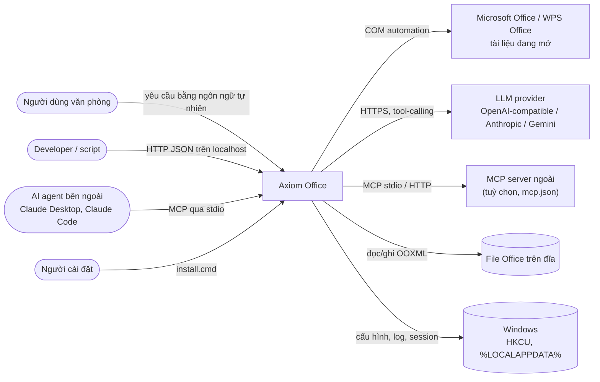

Axiom Office không có server riêng: mọi thứ chạy trên máy người dùng, trong phiên đăng nhập của họ;
dữ liệu của agent (hội thoại, ghi nhớ, audit) là một file SQLite trong `%LOCALAPPDATA%`. Kết nối ra
ngoài chỉ tới LLM provider do người dùng cấu hình (có thể là LLM chạy local như Ollama) và các MCP
server người dùng tự thêm.

## 3. Kiến trúc tổng thể: các container

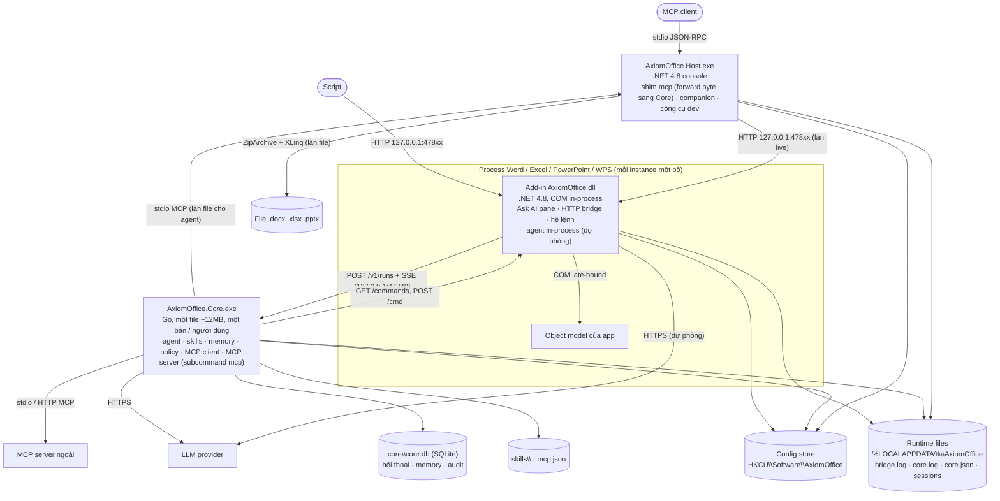

| Container | Công nghệ | Trách nhiệm | Giao tiếp |
|---|---|---|---|
| **Add-in `AxiomOffice.dll`** | .NET 4.8, C# 7.3, COM in-process, WinForms | UI trong app (pane, cài đặt, quản lý ghi nhớ), HTTP bridge, thực thi lệnh trên tài liệu; agent in-process khi Core không dùng được | COM với app; HTTP server loopback; HTTP client tới Core; HTTPS tới LLM (dự phòng) |
| **`AxiomOffice.Core.exe`** | **Go (thuần Go, không cgo; SQLite `modernc.org/sqlite`), một file ~12MB**, một bản / người dùng | Agent cho mọi app: prompt, vòng tool-calling + chuỗi guard, hội thoại, skill, memory dài hạn, policy xác nhận, audit, MCP client, QA | HTTP loopback `127.0.0.1:47840` (+SSE); HTTP client tới bridge; HTTPS tới LLM; stdio/HTTP tới MCP server |
| **`AxiomOffice.Host.exe`** | .NET 4.8 console (biên dịch cùng source add-in) | **Shim chuyển tiếp byte** `mcp` sang Core Go; companion không cần add-in, công cụ dev | stdio với MCP client (và với Core: làn file); HTTP client tới bridge; COM (companion) |
| **Extension LibreOffice** | Python UNO (`.oxt`), chạy trong `soffice` | Bridge HTTP + sidebar Ask AI cho Writer/Calc/Impress (cùng tên lệnh, cùng giao thức) | UNO với tài liệu; HTTP loopback `:47851–47853` |
| **Add-in WPS Linux** | JS add-in (`src/AxiomOffice.WPS`) | Bridge cho WPS Linux qua Core (`:47861`, long-poll) | JS API của WPS; HTTP tới Core |
| **Config store** | Registry HKCU | Port, token, cấu hình LLM (API key mã hoá DPAPI), bật/tắt Core/memory/QA thị giác | Đọc/ghi trực tiếp; Core đọc lại mỗi lượt |
| **Runtime + dữ liệu** | File trong `%LOCALAPPDATA%\AxiomOffice` | Log, `core.json` (tìm Core), `sessions\` (bridge đang sống), `core\core.db`, `skills\`, `mcp.json` | Đọc/ghi trực tiếp |

## 4. Các khối chức năng

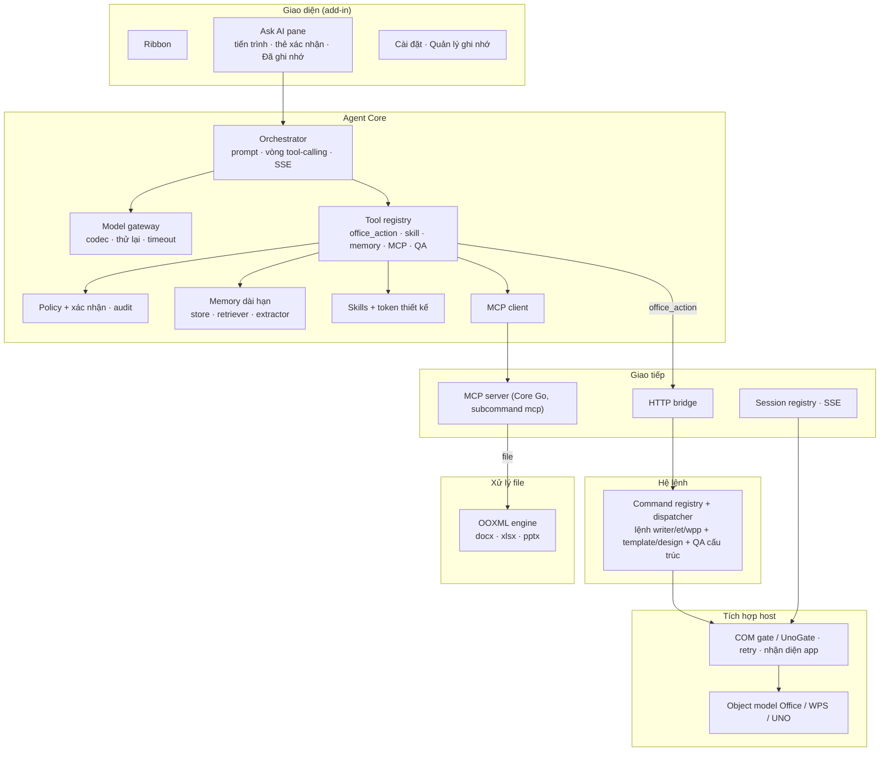

| Khối | Trách nhiệm | Nằm ở |
|---|---|---|
| Giao diện | Ribbon, task pane chat (tiến trình, thẻ xác nhận, dòng "Đã ghi nhớ"), cài đặt, form quản lý ghi nhớ | Add-in |
| Orchestrator | Dựng prompt (quy tắc, chỉ mục skill, memory, ngữ cảnh tài liệu, hội thoại), chạy vòng tool-calling, phát sự kiện SSE, lưu hội thoại + audit | Core |
| Model gateway | Codec OpenAI-compatible / Anthropic, thử lại lỗi tạm thời, timeout, trần token, lọc `<thought>` | Core (bản in-process: `LlmClient`) |
| Tool registry | `office_action` (allowlist từ `/commands`), `load_skill`/`read_skill_file`, `remember`/`recall`, `mcp__*`, `look_at_document` | Core |
| Policy + xác nhận | Hỏi người dùng trước thao tác rủi ro; audit mọi tool call | Core (thẻ xác nhận ở pane) |
| Memory | Ghi nhớ dài hạn học từ mem0 2.2.1: chỉ-ADD, chống trùng, chấm điểm cộng dồn | Core |
| Skills | Kỹ năng theo chuẩn Agent Skills + tầng thiết kế (`_design/tokens.json`) | Core (+ thư mục `skills\`) |
| MCP client | Làn file `office` (Host.exe) + server ngoài trong `mcp.json` | Core |
| HTTP bridge | Cửa vào cho Core/agent/script: xác thực, định tuyến, trả JSON | Add-in (và companion) |
| Session registry · SSE | Cho bên ngoài biết bridge nào đang sống, tài liệu nào đang mở, vùng chọn thay đổi | Add-in |
| **Hệ lệnh** | Danh sách lệnh duy nhất (`writer.*`, `et.*`, `wpp.*`, chung, QA cấu trúc), kiểm tra tham số, thực thi | Add-in (Host dùng chung metadata) |
| Tích hợp host | Tuần tự hoá truy cập COM, thử lại khi app bận, nhận diện loại app | Add-in |
| MCP server + tools | 50 tool cho MCP client: làn live gọi bridge, làn file sửa file trực tiếp | **Core Go (`core-go/internal/mcpserver`)**; `Host.exe mcp` chỉ forward |
| OOXML engine | Đọc/ghi docx/xlsx/pptx không cần app, lưu atomic | Core Go (`internal/ooxml`, `internal/xlsx`, `internal/docx`, `internal/pptx`, `internal/sheet`, `internal/cfb` cho `.xls` BIFF8) |

## 5. Kịch bản chính

### K1: Người dùng nhờ AI sửa tài liệu đang mở

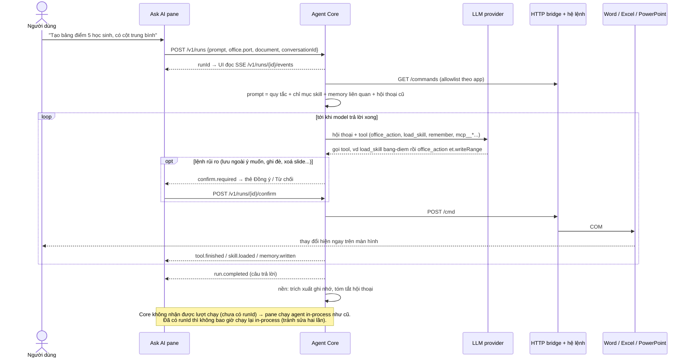

### K6: Ghi nhớ qua các phiên

Phiên 1 người dùng nói "Tôi là trưởng phòng Kế toán, công văn ký tên Nguyễn Văn A" → sau lượt, bộ
trích xuất (một lệnh gọi LLM ở nền, chỉ thêm mới) ghi hai memory `user`. Phiên sau (kể cả sau khi Core
khởi động lại) "Soạn công văn…" → retriever đưa người ký vào prompt. "Tôi đã lên phó giám đốc" → memory
**mới** ghi rõ chuyển đổi và liên kết bản cũ; bản cũ giữ nguyên, ngữ cảnh đặt bản mới trước.

### K7: Xác nhận trước thao tác rủi ro

Model gọi `et.saveAs` dù người dùng không nhắc tới lưu → Core phát `confirm.required`, chờ tối đa
120 giây; Từ chối / hết giờ → model nhận `{"ok":false,"error":"user declined: …"}` và lượt chạy vẫn kết
thúc bình thường. `ai.ask` (agent bên ngoài, không ai bấm) chạy ở chế độ không tương tác: từ chối ngay.

### K2–K4: Agent bên ngoài

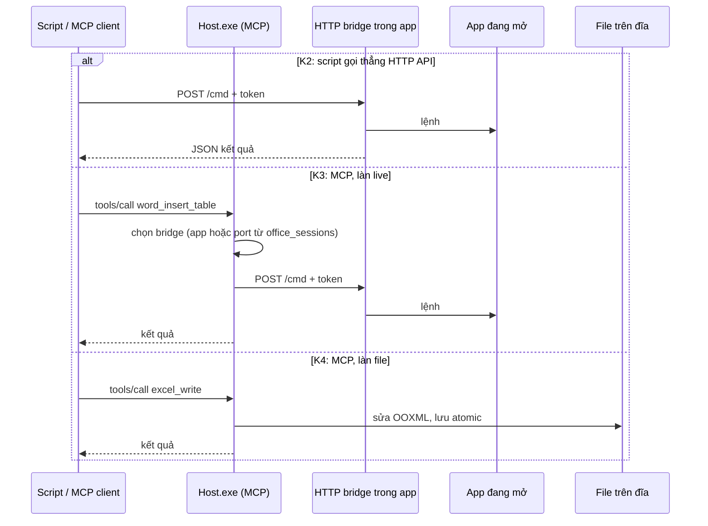

### K5: Tìm các app đang mở

Mỗi bridge ghi một file session (app, port, tài liệu đang mở) và cập nhật định kỳ. MCP tool
`office_sessions` đọc các file này, hỏi `/health` từng bridge, dọn file của process đã chết, trả
danh sách để agent chọn đúng instance (vd khi mở cả Word và WPS Writer).

## 6. Triển khai

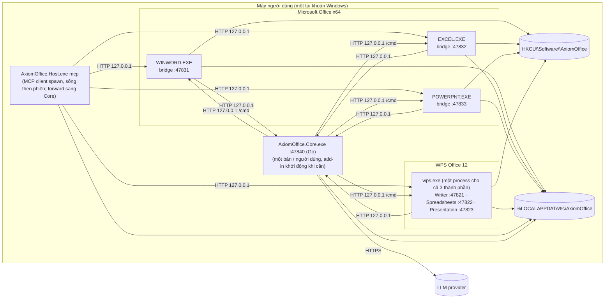

- **Một instance app = một bridge = một port.** Port = port gốc của họ app (WPS 47821, Office
  47831) + 0/1/2 theo loại app (Word, Excel, PowerPoint).
- **Cài đặt**: giải nén zip → `install.cmd` → đăng ký COM và add-in trong HKCU, sinh token. Office
  nạp add-in qua khóa `Addins`, WPS qua whitelist `AddinsWL`. DLL chạy thẳng từ thư mục giải nén.
- **Nâng cấp**: build/giải nén bản mới đè lên, mở lại app. Bản tên cũ `WpsAiBridge` được tự gỡ và
  chuyển cấu hình khi cài.
- **Agent Core**: một process cho mỗi người dùng Windows (mutex `Local\AxiomOffice.Core`; trên Linux
  là `flock` trong `$XDG_RUNTIME_DIR/axiom-office`), chỉ nghe `127.0.0.1`, ghi `core.json`
  (port, pid, version, protocol) khi sẵn sàng. Pane đọc `core.json`, hỏi `/health`, chưa có thì
  khởi động `AxiomOffice.Core.exe` cạnh DLL; build/gỡ cài đặt tắt Core qua `/v1/admin/shutdown`
  (Linux: SIGTERM cũng dừng êm).
- **LibreOffice** (Linux/Windows): extension Python UNO mở ba bridge `:47851` (Writer) /
  `:47852` (Calc) / `:47853` (Impress), cùng giao thức và tên lệnh; session file
  `{pid}-{kind}.json`. Chi tiết: [docs/architecture/libreoffice.md](libreoffice.md).
- **WPS Linux**: JS add-in (`src/AxiomOffice.WPS`) nối long-poll về Core; Core mở bridge `:47861`
  nói đúng giao thức bridge. Chi tiết: [docs/architecture/wps-bridge.md](wps-bridge.md).

## 7. Yêu cầu phi chức năng

| Thuộc tính | Yêu cầu | Cách đáp ứng |
|---|---|---|
| **Bảo mật** | Trang web, máy khác hay process lạ không điều khiển được app; không lộ API key | Chỉ nghe loopback; token 128-bit; chặn request có `Origin`; `/cmd` bắt buộc JSON; API key mã hoá DPAPI, `/config` chỉ trả key đã che |
| **An toàn dữ liệu** | AI không làm mất dữ liệu | Agent chỉ gọi lệnh trong allowlist (không `closeAll`, không tạo sổ Excel mới); không tự lưu/xuất file, **policy xác nhận** khi model vẫn gọi lưu/xuất, ghi đè file, xoá slide, `replaceAll` tài liệu dài, tool MCP ngoài; mỗi thao tác Word = 1 bước Undo; làn file lưu atomic; MCP làn file chỉ mở tool file (tool live đi vòng allowlist bị lọc) |
| **Ổn định host** | Add-in không được làm crash/treo Office | Mọi truy cập COM đi qua một cổng tuần tự; COM call bọc try/catch; thử lại khi app bận; heartbeat/poller bỏ lượt khi app bận; interface host gọi đều là dispinterface |
| **Tương thích** | Office x64 và WPS 12 với cùng một DLL | Late-bound `dynamic`; lệnh viết theo loại app logic; fallback khi API khác nhau (`SaveAs2` → `SaveAs`...). Đã kiểm chứng Office 2024 x64, WPS 12.1 (Writer) |
| **Phản hồi** | UI không đơ; một lượt AI có giới hạn | Agent chạy ở Core, tiến trình qua SSE; 120s mỗi request ngắn (chỉnh được), lượt agent không trần thời gian (giới hạn bằng 100 vòng + nút Dừng); model hỏng thì chuyển model dự phòng; trích xuất ghi nhớ và tóm tắt chạy nền |
| **Bền với LLM** | Lỗi tạm thời của provider không làm hỏng lượt | Thử lại 429/5xx/rớt mạng tối đa 3 lần (1s→2s→4s, theo `Retry-After`); nhắc một lần khi model trả lời rỗng; chuyển model dự phòng khi thử lại không qua; dọn ngữ cảnh + cứu tràn cửa sổ; sửa tên lệnh viết sai nhẹ; gỡ dữ liệu bọc `{"item":…}` |
| **Riêng tư** | Dữ liệu ở lại máy người dùng | Memory/hội thoại/audit trong `core.db` cục bộ; không lưu mật khẩu, số thẻ/CCCD, API key vào memory; model chỉ thêm memory, sửa/xoá chỉ người dùng; `uninstall -Purge` xoá sạch |
| **Quan sát** | Chẩn đoán được lỗi ngay trên máy người dùng | `bridge.log` (pid từng dòng, transcript agent, trạng thái tài liệu khi nạp và ở lệnh đầu tiên); `/health`, `/session`, `office_sessions` |
| **Cài đặt, vận hành** | Không admin, không runtime thêm, gỡ sạch | Toàn bộ đăng ký trong HKCU; chỉ cần .NET 4.8; `uninstall -Purge` xoá cả cấu hình và log |
| **Bảo trì** | Thêm lệnh không phải sửa nhiều nơi | Registry lệnh là nguồn duy nhất; dispatcher, agent, MCP, README sinh từ đó |
| **Kiểm thử được** | Refactor không đổi hành vi | Test live trên app thật có so golden; test MCP so với bản Python; test đồng bộ registry–README |

## 8. Quyết định kiến trúc

| # | Quyết định | Lý do | Đánh đổi |
|---|---|---|---|
| AD-1 | COM add-in .NET Framework 4.8, C# 7.3, không NuGet | Có sẵn trên mọi Windows 10/11; Office và WPS đều nạp được qua mscoree | Không dùng được .NET hiện đại, thư viện ngoài |
| AD-2 | Late-bound `dynamic`, không dùng PIA | Một DLL cho cả Office và WPS, không phụ thuộc phiên bản Office | Không kiểm tra kiểu lúc biên dịch |
| AD-3 | Dispinterface cho mọi interface host gọi | Office/WPS gọi qua IDispatch; khai báo IUnknown làm host crash | Phải khai báo `DispId` thủ công |
| AD-4 | HTTP loopback làm cửa vào chung | Ngôn ngữ nào cũng gọi được, debug bằng curl | Tự lo token, chặn Origin |
| AD-5 | Một cổng COM toàn cục (`ComGate`) | Object model Office không an toàn đa luồng (từng crash Word) | Lệnh chạy tuần tự |
| AD-6 | SSE bằng poll-diff 500ms | Chạy giống nhau trên Office và WPS, không cần COM event sink | Trễ tới 500ms |
| AD-7 | Agent chỉ có một tool `office_action` | Prompt gọn, thêm lệnh không đổi schema tool | Model phải đọc danh sách lệnh trong mô tả |
| AD-8 | Registry lệnh khai báo cạnh handler | Một chỗ sửa; dispatcher, agent, MCP, README không lệch nhau | Mô tả tiếng Việt và gợi ý tiếng Anh nằm cùng dòng |
| AD-9 | MCP server là subcommand `mcp` của Core Go (cùng hợp đồng 50 tool); `Host.exe mcp` chỉ forward byte | Một bản duy nhất cho Windows + Linux, không lệch hợp đồng | Shim giữ để cấu hình MCP client cũ không phải đổi |
| AD-10 | Mọi đăng ký trong HKCU | Không cần admin | Chỉ cài cho từng người dùng |
| AD-11 | Agent Core là process riêng viết bằng Go (một file ~12MB, không runtime, không cgo) | Dùng được SQLite thuần Go, một agent cho mọi app, không làm nặng process Office; build chéo Windows/Linux từ một máy | Thêm một process và giao thức HTTP nội bộ |
| AD-12 | Core chỉ thao tác tài liệu qua bridge (`/cmd`), không gọi COM | Một đường thực thi lệnh duy nhất (allowlist, ComGate, Undo); Core không phụ thuộc Office | Mỗi lệnh thêm một vòng HTTP loopback |
| AD-13 | Pane thử Core trước, dự phòng agent in-process; đã có runId thì không chạy lại | Pane không bao giờ bị khoá vì Core; không sửa tài liệu hai lần | Hai bản agent (C# 7.3 và .NET 10) phải giữ hành vi gần nhau |
| AD-14 | Skill theo chuẩn Agent Skills (thư mục + `SKILL.md`), nạp 3 tầng | Hệ sinh thái sẵn có; prompt gọn (chỉ mục ~100 token/skill) | Không chạy script trong skill |
| AD-15 | Memory tự làm (ban đầu bằng C#, nay bằng Go — `core-go/internal/memory`) theo ý tưởng mem0 2.2.1 (chỉ-ADD) | Dữ liệu ở lại máy, không Python/Docker, model không tự sửa/xoá memory | Tự bảo trì thuật toán chấm điểm; embedding tuỳ chọn |
| AD-16 | Policy xác nhận trong Core, trả lời qua pane | Người dùng quyết định thao tác rủi ro; audit đầy đủ | Lượt chạy có thể dừng chờ tới 120s |
| AD-17 | QA hai mức: cấu trúc bằng số (mặc định) + thị giác (tuỳ chọn) | Agent "mù" vẫn soát được tràn chữ/chồng shape/dữ liệu lạc ô với chi phí thấp | QA thị giác tốn token, cần model đọc ảnh |
| AD-18 | Vòng agent chạy qua chuỗi guard (`model/guards.go`, học LangChain `AgentMiddleware`): `RunAgent` chỉ gọi model + chạy tool, mỗi cơ chế chống lỗi là một guard | Thêm cơ chế mới không sửa vòng lặp; hành vi đã kiểm chứng giữ nguyên | Thứ tự guard có nghĩa, phải giữ khi thêm guard mới |

## 9. Rủi ro và giới hạn

| Rủi ro / giới hạn | Ảnh hưởng | Hướng xử lý |
|---|---|---|
| Exe Core (~12MB, Go, chưa ký số) và DLL chưa ký số | Máy có chính sách chỉ nạp add-in đã ký sẽ không nạp; diệt virus có thể chặn exe | Ký bằng certificate của tổ chức |
| Lệnh WPS Spreadsheets/Presentation chưa chạy test live | Có thể có khác biệt object model chưa phát hiện | Chạy `test_live_commands.py --wps` |
| Bridge xử lý HTTP tuần tự | Request tới cùng app chờ nhau (trừ `ai.ask` và SSE chạy trên thread riêng) | Lệnh COM vẫn tuần tự qua ComGate; `ai.ask` tách thread để Core gọi ngược `/cmd` không kẹt |
| Model free/chậm | Lượt dài, có lúc > 60s một request | Timeout request 120s (chỉnh `LlmRequestTimeoutSeconds`), thử lại, nhắc khi trả lời rỗng; model hỏng thì chuyển model dự phòng (`LlmFallbackModels`) |
| WPS có thể đăng ký đè ProgID `Word/Excel/PowerPoint.Application` | Companion `word|excel|ppt` tạo ra WPS | Mở app Office trực tiếp (add-in tự nạp) |
| Token và key đọc được bởi mọi process cùng tài khoản | Mô hình tin cậy là tài khoản Windows | Chấp nhận (giống mọi app desktop) |
| Excel: `#N/A` đọc ra `null`; `.xls` chỉ đọc; `et.undo` không hoàn tác thay đổi qua COM | Giới hạn của COM/Excel | Ghi rõ trong tài liệu |

---

# Phần II: Low Level Design

## 10. Tổ chức mã nguồn

`AxiomOffice.Host.exe` biên dịch từ **toàn bộ** `src/AxiomOffice/**/*.cs` cộng `src/AxiomOffice.Host/**/*.cs`,
trong đó `Mcp/McpHost.cs` chỉ forward byte sang Core Go (bản MCP C# cũ đã xoá).

```
src/AxiomOffice/                         → AxiomOffice.dll
  Connect.cs                    478      Điểm vào COM: IDTExtensibility2, Ribbon, CTP, IAppHost, nhận diện app
  Interop/                               IDTExtensibility2, IRibbonExtensibility, ICustomTaskPaneConsumer (dispinterface)
  Ribbon/RibbonUi.cs + RibbonChecks.cs   Ribbon XML + xử lý nút + 3 nút Soát (không qua model, 0 token)
  Ai/
    AskAiPane.cs               ~1300     Pane chat: CoreClient + plan mode + đính kèm tệp, hủy, lỗi, chèn trả lời
    PaneControls.cs            ~1300     Control vẽ bằng GDI+, design token PaneTheme
    MarkdownView.cs                      Hiển thị markdown trong bubble trả lời (đậm/nghiêng/mã/link/list/code)
    AiAgent.cs                            System prompt + tool office_action (in-process, dự phòng)
    LlmClient.cs                          OpenAI-compatible / Anthropic, vòng tool-calling, timeout, hủy
    OfficeActionTool.cs                   Định nghĩa tool (từ registry), allowlist, gọi dispatcher
    CoreClient.cs + CoreAdmin.cs          Tìm/khởi động Core, POST /v1/runs + SSE, hủy, confirm, API memory/audit
    SettingsForm.cs + SetupWizardForm.cs  Cài đặt LLM, wizard 5 bước (câu chữ từ catalog/setup.json)
    MemoryForm.cs + AdminForms.cs         Quản lý ghi nhớ, hội thoại trước, nhật ký hoạt động
  Bridge/
    HttpBridge.cs                        HttpListener, kiểm tra Origin/token/Content-Type, định tuyến
    CommandDispatcher.cs                 Execute, retry, lệnh chung, builder Command/Req/Opt
    CommandDispatcher.Writer.cs          Lệnh writer.*
    CommandDispatcher.WriterDesign.cs    Lệnh dựng khối Word theo mẫu (writer.insertBlocks...)
    CommandDispatcher.Spreadsheet.cs     Lệnh et.*
    CommandDispatcher.Presentation.cs    Lệnh wpp.*
    CommandDispatcher.Template.cs        Lệnh làm theo tệp mẫu (newFromTemplate, addSlideFromTemplate,
                                         setShapeText, deleteShapes, copyPicture, sourceManifest)
    CommandDispatcher.Params.cs          Tham số, values, chuyển giá trị COM, Undo, Save
    CommandCatalog.cs                    CommandInfo/CommandParam, sinh chữ ký/markdown/JSON
    ComGate.cs                            Tuần tự hoá COM
    HostProbe.cs                         Tài liệu active, mô tả trạng thái (+ document.view), mã COM retryable
    SessionRegistry.cs                   sessions\{pid}.json, heartbeat
    EventStream.cs                       SSE /events
    Config.cs                            HKCU, port, DPAPI (gồm TavilyApiKey, LlmFallbackModels, LlmContextWindow)
    Logger.cs                            bridge.log
    IAppHost.cs                          Trừu tượng host (add-in / companion)

src/AxiomOffice.Host/                    → AxiomOffice.Host.exe (+ toàn bộ source ở trên)
  HostProgram.cs                         Chọn chế độ: mcp (forward), companion, commands, llm-test
  Mcp/McpHost.cs                         Shim: forward byte stdin/stdout/stderr sang AxiomOffice.Core.exe mcp

core-go/                                 → AxiomOffice.Core.exe (Go, không cgo; chi tiết mục 22)
  cmd/axiom-core                         main: mutex một-phiên-bản, chọn port, HTTP server, subcommand mcp
  internal/config                        AXIOM_* → HKCU / config.json → mặc định; DPAPI/libsecret
  internal/agent                         Orchestrator, RunManager, PromptBuilder (+Plan/Check/Undo/Chunk rules),
                                         ContextAssembler, xác nhận
  internal/model                         Client + vòng RunAgent, codec OpenAI/Anthropic, chuỗi guard, fallback,
                                         cửa sổ ngữ cảnh, live stream
  internal/tools                         office_action (+read-only plan mode), skill, memory, todo, tavily_search
                                         (Tavily), visual, template_build, truncate
  internal/skills                        SkillIndex/Loader (chuẩn Agent Skills, 3 nguồn, watch 2s)
  internal/memory                        Store (chỉ-ADD, hash+cosine), Retriever (BM25+entity+embedding),
                                         Extractor (nền, 1 LLM call)
  internal/policy                        PolicyEngine (hỏi lưu/xuất, ghi đè, xoá slide, replaceAll dài)
  internal/mcp                           MCP client (stdio + Streamable HTTP, server built-in office)
  internal/mcpserver                     MCP server 50 tool (subcommand mcp) + engine OOXML
  internal/ooxml|xlsx|docx|pptx|sheet|cfb  Đọc/ghi file trực tiếp, .xls BIFF8 thuần Go
  internal/office                        BridgeClient (/cmd, /commands, /session), SessionDirectory
  internal/api                           Core API v1 (runs, SSE, confirm, conversations, skills, memory, audit,
                                         setup, mcp, admin) + kênh /wps cho WPS Linux
  internal/store                         SQLite core.db (schema 3): hội thoại, lượt chạy, audit
  internal/setup                         /v1/setup, /v1/llm/*, catalog sinh từ catalog/setup.json

src/AxiomOffice.LibreOffice/             → axiom-office.oxt (Python UNO; thiết kế docs/architecture/libreoffice.md)
  python/pythonpath/axiom/               bridge.py, commands.py (cùng tên lệnh), writer.py, calc.py,
                                         impress.py, checks.py, gate.py (UnoGate), sessions.py, pane.py,
                                         chat.py, awt.py, setup*.py, theme.py...

src/AxiomOffice.WPS/                     → add-in JS cho WPS Linux (thiết kế docs/architecture/wps-bridge.md)
  commands.js, main.js, probe.js         appKind/catalogFor theo app, 16 lệnh writer.* + 23 et.* + 15 wpp.*

skills/                                  Skill dựng sẵn + _design/tokens.json (chép cạnh exe khi build)
catalog/                                 live-commands.json (nguồn mô tả tool MCP live),
                                         setup.json (nguồn duy nhất cho wizard 3 nền tảng)
scripts/                                 build, install, uninstall, legacy, package, core.ps1; dist/ (install.cmd...);
                                         linux/ (package.sh, install.sh); wps/ (install_jsaddon.py)
tests/live/                              test lệnh bridge trên app thật (Office/WPS)
tests/lo/                                test extension LibreOffice (unit + live + checks)
tests/wps/                               test bridge WPS Linux (Core e2e + add-in Node + live)
tests/core/                              e2e Agent Core (fake_llm.py, test_core_e2e.py 14 phần)
tests/mcp-host/                          test MCP server (portable, parity sâu, oracle_diff, round-trip)
tests/bench/                             benchmark Calc + lộ trình hiệu năng
```

## 11. Add-in: vòng đời, nhận diện app, UI

### 11.1 Vòng đời

Office/WPS tạo `AxiomOffice.Connect` qua COM (`mscoree.dll` + `CodeBase` trong HKCU). `Connect`
implement `IDTExtensibility2`, `IRibbonExtensibility`, `ICustomTaskPaneConsumer` (đều là
dispinterface) và `IAppHost`.

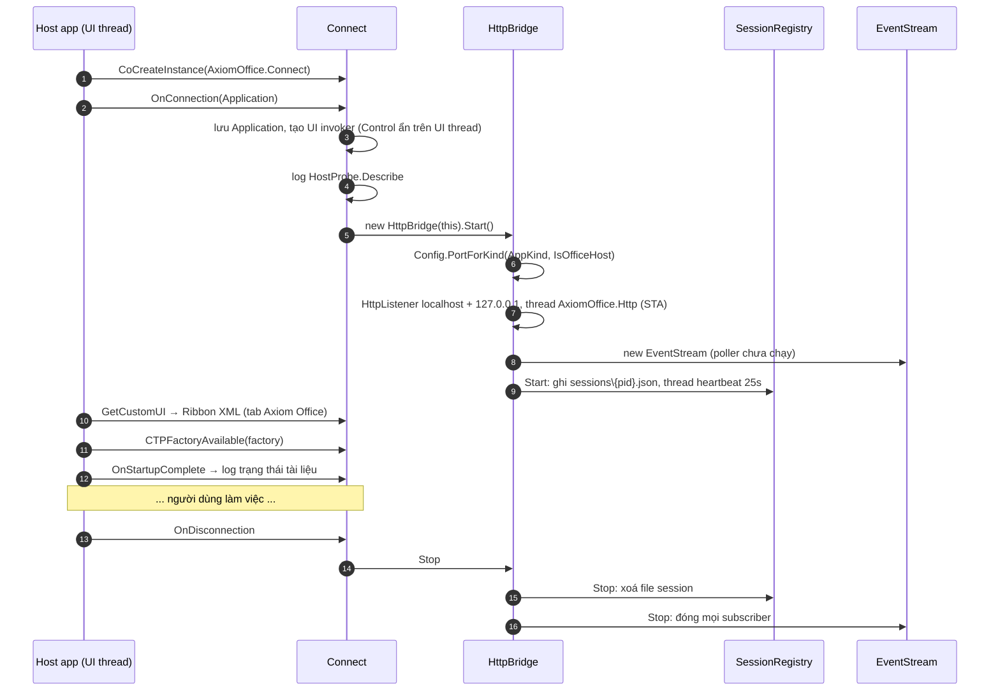

Mọi hàm host gọi vào đều bọc try/catch và log: lỗi trong add-in không được lan ra host.

### 11.2 Nhận diện app và port

`Connect.AppKind` dò bằng COM chứ không bằng tên process (WPS 12 chạy mọi thành phần trong cùng
`wps.exe`): có `Documents` → `wps`, có `Workbooks` → `et`, có `Presentations` → `wpp`; thất bại mới
đoán theo tên process. `IsOfficeHost` = process là `winword` / `excel` / `powerpnt`.

| App | `AppKind` | `family` | Port (`Config.PortForKind`) |
|---|---|---|---|
| WPS Writer | `wps` | `wps` | `Port` = 47821 |
| WPS Spreadsheets | `et` | `wps` | `Port` + 1 = 47822 |
| WPS Presentation | `wpp` | `wps` | `Port` + 2 = 47823 |
| Microsoft Word | `wps` | `office` | `PortOffice` = 47831 |
| Microsoft Excel | `et` | `office` | `PortOffice` + 1 = 47832 |
| Microsoft PowerPoint | `wpp` | `office` | `PortOffice` + 2 = 47833 |

### 11.3 Ribbon và task pane

- **Ribbon** (tab *Axiom Office*): nhóm *Local bridge* gồm **Status**, **Copy API URL**, **Open Log**;
  nhóm *AI* gồm **Ask AI...**, **Settings**. Nút gọi `Connect.OnButtonAction(control)` → `RibbonUi.HandleButton(tag)`.
- **Task pane**: factory nhận ở `CTPFactoryAvailable`; `CreateCTP("AxiomOffice.AskAiPane", "Axiom Office")`
  luôn chạy trên UI thread qua `Connect.OnUiThread` (lệnh `ui.askpane` đến từ thread HTTP: tạo CTP ở
  đó thì RCW của pane thuộc apartment của thread HTTP). Host không hỗ trợ CTP → cửa sổ nổi
  `AskAiHostForm`.
- **Độ rộng pane**: WPS 12 mở pane hẹp (~250px) và áp độ rộng trễ; `AskAiPane.ScheduleWidthCheck`
  đo lại tối đa 3 lần và gọi `Connect.AdjustTaskPaneWidth` để nới về 360px (quy đổi point/pixel
  theo tỉ lệ đo được).

## 12. Mô hình thread và ComGate

Word từng crash (AV trong `wwlib.dll`) khi heartbeat đọc `ActiveDocument` đúng lúc `ai.ask` đang
ghi: cuộc gọi thứ hai được dispatch reentrant trong vòng message của Word. Vì vậy **mọi thread của
add-in gọi COM qua `ComGate`** (một `lock` toàn cục).

| Thread | Tạo bởi | Việc | Cách vào COM |
|---|---|---|---|
| UI thread của host | Office/WPS | Ribbon, task pane, tạo CTP | Trực tiếp |
| `AxiomOffice.Http` (STA) | `HttpBridge` | Nhận và xử lý **tuần tự** mọi request | `ComGate.Run` (chờ tới lượt) |
| ThreadPool worker | `AskAiPane.StartRun` | Một lượt agent của pane | Mỗi tool qua `ComGate.Run` |
| `AxiomOffice.Session` | `SessionRegistry` | Heartbeat 25s | `ComGate.TryRun(0)` trên threadpool, chờ tối đa 2s |
| `AxiomOffice.EventPoll` | `EventStream` | Poll 500ms khi có subscriber | `ComGate.TryRun(0)`: bận thì bỏ lượt |
| `AxiomOffice.Events#n` | `EventStream` | Ghi SSE cho từng subscriber | Không gọi COM |

```csharp
internal static class ComGate
{
    public static T Run<T>(Func<T> action);             // lock: chờ tới lượt (lệnh, tool của agent)
    public static bool TryRun(int timeoutMs, Action a); // Monitor.TryEnter: bận thì trả false
}
```

Hai lệnh không đi qua cổng ở mức dispatcher (`CommandInfo.Gated = false`): `ai.ask` (giữ lệnh hàng
chục giây, từng tool tự qua cổng) và `ui.askpane` (chuyển sang UI thread; giữ cổng có thể deadlock
với UI thread đang chờ cổng).

## 13. HTTP bridge

`HttpBridge` dùng `HttpListener` với prefix `http://localhost:{port}/` và `http://127.0.0.1:{port}/`.
Thread pump xử lý từng request một; `/events` giao cho thread riêng để pump quay lại ngay.

### 13.1 Endpoint

| Endpoint | Token | Trả về |
|---|---|---|
| `GET /health` | Không | `{"ok":true,"result":{"app","pid","port","version","log"}}` |
| `GET /config` | Có | `provider`, `endpoint`, `model`, `apiKey` đã che (`abcd...wxyz`) |
| `GET /session` | Có | Snapshot session (mục 16) + `sessionFile`; đọc tài liệu live, chờ cổng tối đa 2s |
| `GET /events` | Có | Server-Sent Events (mục 17) |
| `POST /cmd` | Có | `{"action","params"}` → `{"ok":true,"result":...}` / `{"ok":false,"error":...}` |

### 13.2 Pipeline xử lý request

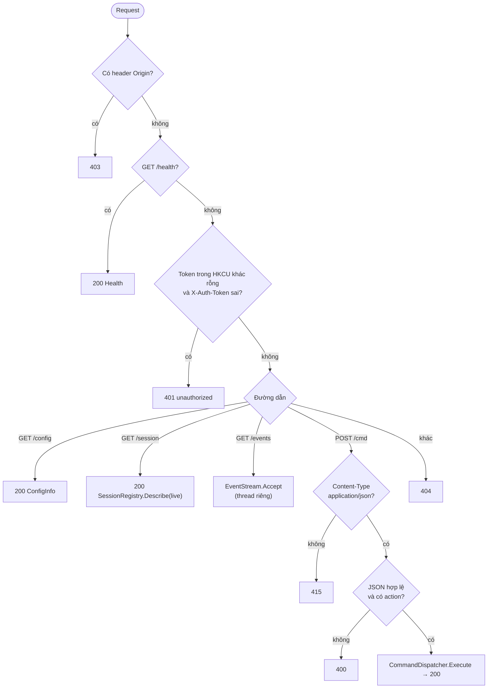

### 13.3 Mô hình lỗi

| Tình huống | HTTP | Body |
|---|---|---|
| Lệnh chạy xong | 200 | `{"ok":true,"result":{...}}` |
| Lỗi nghiệp vụ (tham số sai, không có tài liệu, sai loại app, lệnh không tồn tại, COM lỗi) | 200 | `{"ok":false,"error":"KiểuLỗi: message"}` |
| Có `Origin` / thiếu token / sai Content-Type / JSON hỏng / thiếu `action` | 403 / 401 / 415 / 400 / 400 | `{"ok":false,"error":...}` |
| Session registry / event stream chưa chạy | 503 | `{"ok":false,"error":...}` |
| Exception không lường trước trong pump | 500 | `{"ok":false,"error":"internal error: ..."}` |

Nếu giá trị `Token` trong HKCU rỗng thì bỏ qua kiểm tra token (install luôn sinh token).

## 14. Hệ lệnh: registry và dispatcher

### 14.1 Mô hình

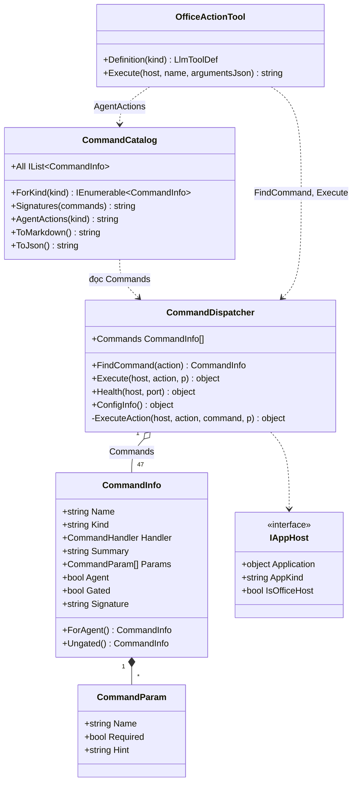

- `CommandHandler` = `delegate object (IAppHost host, Dictionary<string, object> p)`.
- `Kind`: `null` (mọi app), `wps`, `et`, `wpp`. `Agent`: có trong tool `office_action`. `Gated`: chạy
  trong `ComGate`.
- `Signature`: `et.readRange {range,sheet}`; tham số có hint: `values (2D array of rows)`.

Khai báo đặt cạnh handler, mỗi lệnh một dòng:

```csharp
Command("et.writeRange", "et", EtWriteRange, "Ghi vùng bắt đầu từ ô trên-trái `range`",
    Req("range", "top-left cell e.g. 'A1'"), Req("values", "2D array of rows e.g. ..."), Opt("sheet")).ForAgent(),
```

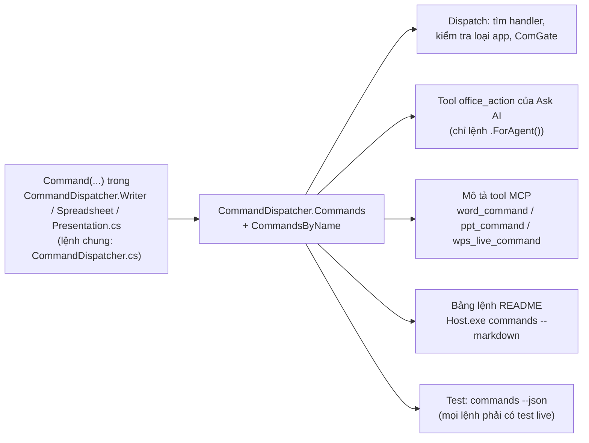

| File | Nội dung |
|---|---|
| `CommandDispatcher.cs` | `Execute`, retry, `EnsureVisibleWordDocument`, `Health`, `ConfigInfo`, builder `Command`/`Req`/`Opt`, lệnh chung (`app.info`, `ai.ask`, `ui.askpane`, `app.screenshot`) |
| `CommandDispatcher.Writer.cs` | Lệnh `writer.*` (đọc/ghi/định dạng văn bản, bảng, ảnh) |
| `CommandDispatcher.WriterDesign.cs` | Lệnh dựng khối Word theo mẫu (`writer.insertBlocks`...) |
| `CommandDispatcher.Spreadsheet.cs` | Lệnh `et.*` |
| `CommandDispatcher.Presentation.cs` | Lệnh `wpp.*` |
| `CommandDispatcher.Template.cs` | Lệnh làm theo tệp mẫu (`newFromTemplate`, `addSlideFromTemplate`, `setShapeText`, `deleteShapes`, `copyPicture`, `sourceManifest`) |
| `CommandDispatcher.Params.cs` | Đọc tham số, giải mã `values`, chuyển giá trị COM, `UndoRecordScope`, `SaveDocument` |
| `CommandCatalog.cs` | `CommandInfo`, `CommandParam`, sinh chữ ký / markdown / JSON |

| Nhóm | Cho agent (`ForAgent`) | Không cho agent (ví dụ) |
|---|---|---|
| Chung | `app.screenshot` (QA thị giác, agent gọi qua `look_at_document`, không gọi thẳng) | `app.info`, `ai.ask`, `ui.askpane` |
| `writer.*` | đọc/ghi/định dạng, `replaceAll`/`replaceMany`, `checkTables`, `insertBlocks` | `newDocument`, `open`, `closeAll` |
| `et.*` | đọc/ghi nhiều vùng, `fillRange`, chart, conditional format, `checkRange` | `open` |
| `wpp.*` | slide/text/ảnh/bảng/notes, `checkLayout`, `sourceManifest`, `addSlideFromTemplate`... | `newPresentation`, `open`, `addTextBox` |

Tổng registry C# hiện **77 lệnh** (tăng từ 47 ban đầu sau các đợt template/design/`replaceMany`/khoá vùng chọn); danh sách chuẩn
nằm ở `catalog/live-commands.json` (gồm cả biến thể LibreOffice/WPS, 80 mục, 57 `agent=true`) và bảng
*Danh sách lệnh* trong README (sinh bằng `commands --markdown`).

### 14.2 Luồng thực thi

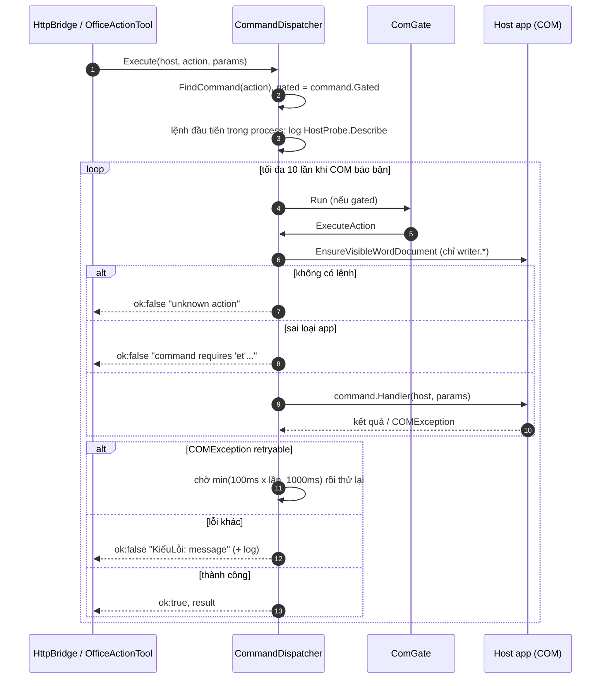

- **COM bận** (thử lại, tổng chờ tối đa ~5,5s): `0x80010001` RPC_E_CALL_REJECTED, `0x8001010A`
  RPC_E_SERVERCALL_RETRYLATER, `0x80010002` RPC_E_CALL_CANCELED, `0x800AC472` (Excel đang sửa ô).
- **`EnsureVisibleWordDocument`**: với `writer.*` (trừ `newDocument`, `open`, `closeAll`), nếu
  `ActiveDocument` không có cửa sổ hiển thị mà có tài liệu khác đang hiển thị thì kích hoạt tài liệu
  đó trước (Word luôn có một cửa sổ ẩn lúc khởi động).
- **`RequireKind`** làm một lần ở dispatcher theo `CommandInfo.Kind`.
- **`CommandRejectedException`**: lỗi trả nguyên văn, không kèm tên kiểu, không log (vd `ui.askpane`
  gọi từ companion).
- **Undo**: handler sửa tài liệu Word bọc trong `UndoRecordScope`
  (`Application.UndoRecord.StartCustomRecord/EndCustomRecord`) nên mỗi thao tác = 1 bước Ctrl+Z;
  host không có `UndoRecord` thì bỏ qua.
- **Lưu**: `SaveDocument` dùng `SaveAs2(path)`, lỗi thì `SaveAs(path)`; `wpp.exportPdf` dùng
  `ExportAsFixedFormat(path, 2)`, lỗi thì `SaveAs(path, 32)`.

### 14.3 Đọc tham số

| Hàm | Quy tắc |
|---|---|
| `ParamString` | `Convert.ToString`, thiếu thì dùng mặc định |
| `ParamInt` | Nhận số và chuỗi số (`"44"`, `"12.0"`, invariant culture). Sai kiểu → `'layout' must be a whole number, got 'Title Only'` |
| `ParamBool` | Nhận `true/false` và chuỗi tương ứng. Sai kiểu → `'bold' must be true or false, got 'có'` |
| `ParamMatrix` | Mảng 2 chiều `values` (`et.writeRange`, `writer.insertTable`, `wpp.addTable`) |

`ParamMatrix`:

1. Chuỗi bắt đầu bằng `[` hoặc `{` → parse JSON.
2. `DecodeArrays`: mỗi lớp `{"item"|"items"|"row"|"rows"|"values": x}` là **một cấp mảng**; `x` là
   danh sách phần tử, hoặc phần tử duy nhất khi `x` không phải mảng. Ví dụ
   `{"item":{"item":["Tổng","=SUM(B2:B3)"]}}` = `[["Tổng","=SUM(B2:B3)"]]` (một dòng).
3. Bỏ lớp bọc thừa ngoài cùng: `[[["a","b"],["c","d"]]]` → `[["a","b"],["c","d"]]`.
4. Mảng 1 chiều = một cột (mỗi phần tử một dòng).
5. Ô bị bọc thành mảng một phần tử được gỡ; ô là mảng/object thật → lỗi.
6. Sai dạng → `ArgumentException` kèm ví dụ đúng để model tự sửa ở vòng sau; không bao giờ trả
   `ok:true` mà không ghi gì.

Chiều ra, `ToPlain` / `ToMatrix` chuyển giá trị COM sang JSON: `object[,]` 1-based của
`Range.Value2` thành list dòng, `DateTime` thành ISO 8601, mã lỗi Excel thành tên (`#DIV/0!`,
`#REF!`...); `#N/A` thành `null` (COM trả cùng mã với ô trống).

### 14.4 Thêm một lệnh

1. Viết handler `private static Dictionary<string, object> XxxYyy(IAppHost host, Dictionary<string, object> p)`
   trong file partial của app.
2. Thêm một dòng `Command("xxx.yyy", kind, XxxYyy, "mô tả tiếng Việt", Req(...), Opt(...))`, gắn
   `.ForAgent()` nếu agent của pane được dùng.
3. `AxiomOffice.Host.exe commands --markdown` → chép đè bảng lệnh trong README (test MCP báo lỗi nếu
   lệch).
4. Thêm lệnh vào `tests/live/test_live_commands.py` (test báo lỗi nếu có lệnh chưa được gọi).

## 15. AI agent

### 15.1 Thành phần

| Class | Vai trò |
|---|---|
| `AskAiPane` | UI chat: gửi prompt, hiện từng thao tác, Dừng, Thử lại, Chèn trả lời (`writer.insertStyledText`) |
| `PaneControls` | `PaneTheme` (design token, scale DPI), `ChatBubble`, `ToolLine`, `TypingBubble`, `PromptBox`, `ComposerPanel`, `ErrorCard`, `ChatList`... |
| `AiAgent` | Dựng system prompt theo loại app, gắn tool `office_action`, gọi `LlmClient.RunAgent` (đường dự phòng) |
| `LlmClient` | Vòng tool-calling in-process; `Chat` cho nút Test và `llm-test` |
| `OfficeActionTool` | Định nghĩa tool (mô tả sinh từ registry), allowlist, thực thi → `CommandDispatcher` |
| `MarkdownView` | Hiển thị markdown trong bubble trả lời (đậm/nghiêng/mã/link/list/khối mã) |
| `SettingsForm` | Provider, endpoint, model, API key (lưu DPAPI), Tavily key, nút Test; bật/tắt Core, ghi nhớ, tự ghi nhớ, QA thị giác, model dự phòng, cửa sổ ngữ cảnh; mở Quản lý ghi nhớ |
| `SetupWizardForm` + `SetupWizardControls` | Wizard 5 bước (câu chữ từ `catalog/setup.json`), tự mở một lần khi chưa cấu hình, bước 5 **Thử ngay** qua Core |
| `CoreClient` + `CoreAdmin` | Tìm/khởi động Agent Core, `POST /v1/runs` + đọc SSE, hủy, trả lời xác nhận, API memory/audit/skills/mcp (mục 22.11) |
| `MemoryForm` + `AdminForms` | Xem, thêm, sửa, ghim, hạn dùng, xoá/khôi phục, lịch sử, xoá toàn bộ ghi nhớ; hội thoại trước; nhật ký hoạt động; kỹ năng; trạng thái |
| `McpForm` (+`McpServerEditForm`, `McpFile`) | Nút ribbon Công cụ ngoài…: gộp mcp.json + `GET /v1/mcp`, bật/tắt, tin cậy, thêm/sửa/xoá server; ghi UTF-8 không BOM |

Pane chạy qua **Agent Core** (mục 22) là đường chính; `AiAgent`/`LlmClient` là **dự phòng in-process**
khi Core không nhận được lượt chạy (đã có runId thì không bao giờ chạy lại in-process, tránh sửa
tài liệu hai lần), và là đường chạy của companion (`Host.exe word|excel|ppt`). Core không chạy
trong plan mode thì pane **báo lỗi** thay vì rơi về in-process (agent đó không có chế độ chỉ đọc).

### 15.2 Một lượt chạy (đường chính: qua Core; xem mục 22.3)

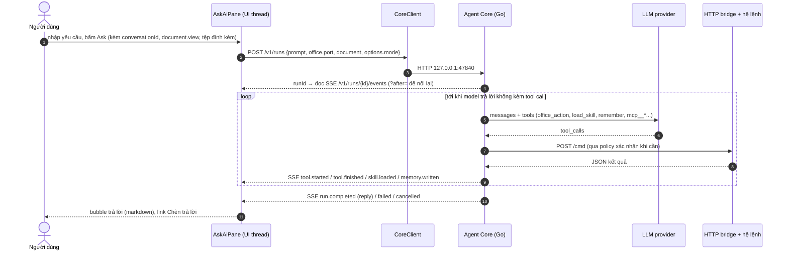

Đường dự phòng in-process (Core không nhận lượt chạy) đi như cũ qua `AiAgent`/`LlmClient` trên
ThreadPool worker, mỗi tool qua `ComGate.Run`:

```
    U->>P: nhập yêu cầu, bấm Ask
    P->>W: QueueUserWorkItem (CancellationTokenSource)
    W->>AG: AiAgent.Run(host, prompt, progress, token)
    loop tới khi model trả lời không kèm tool call
        AG->>L: messages + tool office_action (timeout 120s/request)
        L-->>AG: tool_calls
        AG->>T: Execute(office_action, {action, params})
        alt action không có ForAgent
            T-->>AG: ok:false "not an available action"
        else
            T->>D: Execute(host, action, params)
            D-->>T: ok / error
            T-->>AG: JSON kết quả
        end
        AG-->>P: progress (BeginInvoke) → một dòng ToolLine
    end
    L-->>AG: câu trả lời cuối
    AG-->>W: LlmResult (Ok, Text, Transcript, Rounds, Seconds)
    W-->>P: FinishRun (BeginInvoke)
    P-->>U: bubble trả lời, link Chèn trả lời
```

```mermaid
stateDiagram-v2
    [*] --> Idle
    Idle --> Running: Ask / Enter
    Running --> Running: tool call + progress
    Running --> Done: model trả lời xong
    Running --> Cancelled: bấm Dừng (hủy request đang chờ / POST /cancel với Core)
    Running --> TimedOut: quá trần (in-process: 5 phút; Core: hết ngân sách token → run.stopped)
    Running --> Failed: lỗi provider / cấu hình
    Done --> Idle
    Cancelled --> Idle
    TimedOut --> Idle: ErrorCard + Thử lại
    Failed --> Idle: ErrorCard + Thử lại / Mở Cài đặt
```

### 15.3 Giao thức với LLM

| Provider | Endpoint | Header | Tool format |
|---|---|---|---|
| `openai` (OpenAI-compatible, cả Ollama, LM Studio...) | `{endpoint}/chat/completions` | `Authorization: Bearer <key>` | `tools` + `tool_calls` / role `tool` |
| `anthropic` | `{endpoint}/messages` | `x-api-key`, `anthropic-version: 2023-06-01` | `tools` + `tool_use` / `tool_result` |

- `LlmResult`: `Ok`, `Text`, `Error`, `Seconds`, `Rounds`, `Transcript`, `Cancelled`, `TimedOut`,
  `StepLimitReached`, `ViaCore`, `ConversationId`, `RunId`.
- **Thời gian (in-process)**: `TimeoutMs` = 120s mỗi request; `AgentTimeoutMs` = 300s cả lượt (linked
  `CancellationTokenSource`); hủy gọi `HttpWebRequest.Abort()` nên dừng ngay. **Core không đặt trần
  thời gian mặc định** (kiểm soát bằng số vòng + nút Dừng; bên gọi vẫn đặt `maxSeconds` được, vd `ai.ask`).
- **Số vòng**: in-process không giới hạn (`maxIterations` = 0); Core mặc định 100 vòng
  (`options.maxRounds`, tối đa 1000) và ngân sách token (mặc định không trần; bên gọi đặt `maxTokens` được).
- **Provider không hỗ trợ tools**: lỗi có chữ "tool" → tắt tools, chạy tiếp như chat thường.

### 15.4 Quy tắc của agent

- **Một tool** `office_action {action, params}`; mô tả liệt kê chữ ký các lệnh `ForAgent()` của loại
  app đang mở (`CommandCatalog.AgentActions`), vd `et.writeRange {range (top-left cell e.g. 'A1'),values (...),sheet}`.
- **Allowlist**: `OfficeActionTool` từ chối lệnh không có `ForAgent` (vd `writer.closeAll`, `ai.ask`
  lồng nhau), log `office_action refused: <action>`. HTTP API và MCP không bị giới hạn này.
- **System prompt**: dùng `office_action` cho mọi thay đổi để người dùng thấy trực tiếp; đọc tài
  liệu khi cần; viết nội dung bằng ngôn ngữ của người dùng; **không `save` / `saveAs` / `exportPdf`
  nếu người dùng không yêu cầu**; không bịa kết quả tool; trả lời tóm tắt 1–2 câu.
- **Hội thoại liên tục**: các lượt trong cùng tài liệu nối thành một cuộc trò chuyện (lưu ở Core,
  `core.db`); "làm tiếp" hiểu ngữ cảnh lượt trước. Link **Trò chuyện mới** để bắt đầu lại.
- **Plan mode** (`options.mode = "plan"`): lượt chỉ đọc, trả về kế hoạch (mục tiêu · bước đánh số ·
  cách kiểm · câu hỏi kèm phương án mặc định an toàn nhất); bước thực hiện là lượt thường tiếp theo
  trong cùng hội thoại. Pane có công tắc "Lập kế hoạch trước" và thẻ "Thực hiện kế hoạch".
- **Nhật ký** trong `bridge.log`: `AskAiPane: prompt=`, `AskAiPane progress:` (từng tool call + kết
  quả), `AskAiPane: ok ... N tool calls, M rounds`; ghi ngay trên worker kể cả khi pane đã đóng.
- **`ai.ask`** (lệnh bridge) chạy qua Core ở chế độ không tương tác (`interactive=false`) trên thread
  riêng của bridge, trả `reply`, `transcript`, `seconds`, `rounds`, thêm `viaCore`, và log
  `ai.ask progress:`. Core không dùng được thì chạy agent in-process như trước.

## 16. Session registry

File `%LOCALAPPDATA%\AxiomOffice\sessions\{pid}.json`:

| Trường | Ý nghĩa |
|---|---|
| `pid`, `host` | Process của app (`WINWORD.EXE`, `wps.exe`...) |
| `app`, `family` | `wps`/`et`/`wpp`; `office`/`wps` |
| `port`, `version` | Port bridge, version DLL |
| `started`, `lastSeen`, `lastSeenEpoch` | ISO UTC và epoch giây của lần heartbeat gần nhất |
| `document`, `documentPath` | Tài liệu đang active (cache) |

```json
{"pid":5128,"app":"wps","family":"office","port":47831,"host":"WINWORD.EXE","version":"1.0.0",
 "started":"2026-09-28T21:25:42.965Z","lastSeen":"...","lastSeenEpoch":1790630759.1,
 "document":"bao-cao.docx","documentPath":"C:\\...\\bao-cao.docx"}
```

- Ghi atomic (`.tmp` + `File.Replace`), heartbeat 25s. Đọc tài liệu trên threadpool qua
  `ComGate.TryRun(0)`, chờ tối đa 2s: host bận thì giữ tên đã cache nhưng `lastSeen` vẫn ghi đúng hạn.
- `GET /session` đọc live (chờ cổng tối đa 2s) rồi ghi lại file ngay.
- `OnDisconnection` xoá file. File mồ côi (process chết bất thường) bị `BridgeClient.Sessions` xoá
  khi process không còn, hoặc `lastSeen` quá 90s mà `/health` không trả đúng pid. Kết quả thêm
  `healthy`, `ageSeconds`, `file`, sắp theo `family` rồi `port`.

## 17. Event stream (SSE)

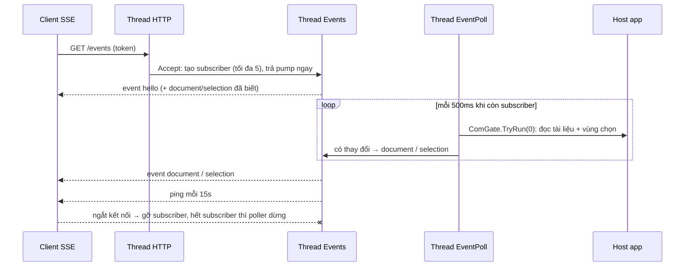

| Event | Dữ liệu |
|---|---|
| `hello` | `app`, `family`, `port`, `pid`, `subscribers` |
| `document` | `app`, `name`, `fullName` |
| `selection` (Writer) | `app`, `text`, `start`, `end` |
| `selection` (Spreadsheets) | `app`, `sheet`, `address`, `text` |
| `selection` (Presentation) | `app`, `slide`, `type`, `shape`, `text`, `start`, `end` |
| `ping` | `time`, `subscribers` |

`text` cắt 200 ký tự; vùng chọn Word dài hơn 5000 ký tự chỉ đọc phần đầu. Lỗi poll log tối đa 1
dòng/phút cho mỗi loại. Response đặt `Cache-Control: no-cache`, `X-Accel-Buffering: no`, chunked.

## 18. Host.exe: MCP server và companion

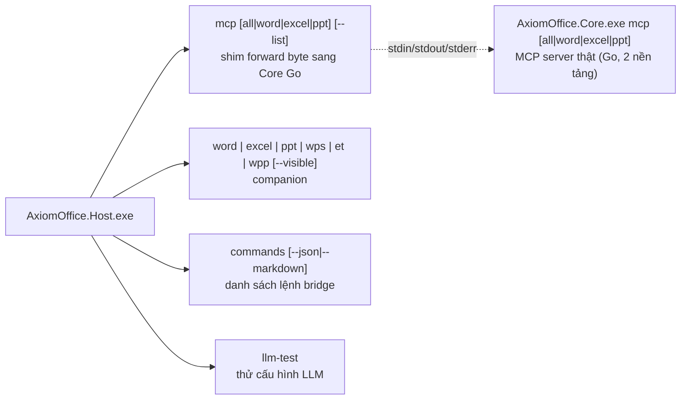

### 18.1 MCP server (bản Go duy nhất: `core-go/internal/mcpserver`)

- `AxiomOffice.Host.exe mcp` chỉ nối thẳng stdin/stdout/stderr sang tiến trình con
  `AxiomOffice.Core.exe mcp` theo byte (không giải mã/mã lại), nên cấu hình MCP client cũ giữ nguyên.
  Gói cài thiếu Core thì báo rõ và thoát mã 2.
- JSON-RPC 2.0 qua stdio, mỗi message một dòng, hỗ trợ batch; tự viết, không dùng SDK. `stdout`
  chỉ dành cho JSON-RPC, log ra `stderr`.
- Phương thức: `initialize` (protocol `2025-11-25`, `2025-06-18`, `2025-03-26`, `2024-11-05`; client
  xin version lạ thì trả bản mới nhất), `ping`, `tools/list`, `tools/call`; notification bỏ qua,
  method lạ → `-32601`.
- `tools/call` trả `content: [{type:"text", text}]`; exception trong tool → `isError: true` với
  `{"ok":false,"error":...}`.
- Nhóm: `all` (50 tool, server `office-tools`), `word` (20), `excel` (16), `ppt` (16); nhóm nào cũng
  có `office_sessions`. Mô tả tool `*_command` sinh từ `catalog/live-commands.json`
  (sinh bằng `scripts/generate_mcp_commands.py`, nhúng vào Go qua `livecommands_gen.go`).

| Nhóm | Làn file (không cần app) | Làn live (qua bridge) |
|---|---|---|
| Word | `doc_profile`, `doc_get_text`, `doc_find_text`, `doc_extract_table`, `doc_create` (5) | `word_health`, `word_command`, `word_read_text`, `word_type_text`, `word_insert_styled_text`, `word_format_selection`, `word_heading`, `word_insert_table`, `word_insert_image`, `word_insert_hyperlink`, `word_replace_all`, `word_export_pdf`, `word_undo`, `word_save` (14) |
| Excel | `excel_profile`, `excel_read`, `excel_write`, `excel_create`, `excel_convert`, `excel_format_range`, `excel_create_table`, `excel_create_sheet`, `excel_copy_sheet`, `excel_rename_sheet`, `excel_delete_sheet` (11) | `wps_health`, `wps_live_command`, `wps_live_read_range`, `wps_live_write_range` (4) |
| PowerPoint | `ppt_profile`, `ppt_get_text`, `ppt_create`, `ppt_add_slide_file` (4) | `ppt_health`, `ppt_command`, `ppt_list_slides`, `ppt_add_slide`, `ppt_add_text`, `ppt_add_image`, `ppt_add_table`, `ppt_set_notes`, `ppt_delete_slide`, `ppt_export_pdf`, `ppt_save` (11) |
| Chung | | `office_sessions` (1) |

Tên và tham số của 50 tool là hợp đồng với client (tương thích bản Python cũ); chỉ mô tả của
`*_command` sinh từ registry lệnh.

### 18.2 Làn live

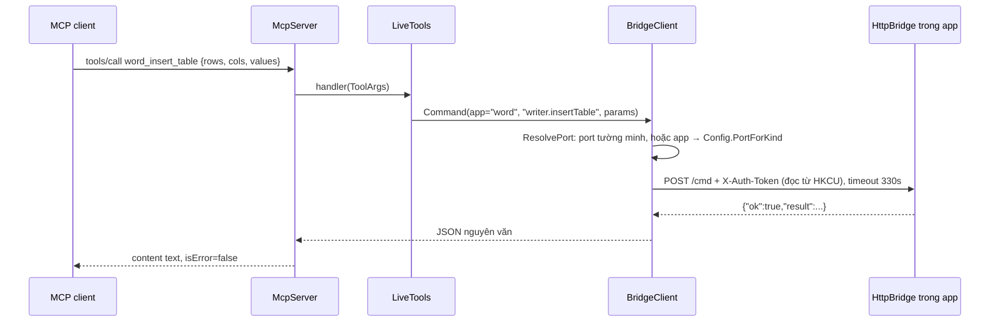

- `app`: `word`/`excel`/`ppt` (Office) hoặc `wps`/`et`/`wpp` (WPS); `port` tường minh ưu tiên hơn.
- Timeout 330s vì `ai.ask` có trần 5 phút.
- Lỗi kết nối (app chưa mở, add-in chưa nạp) trả `{"ok":false,"error":...}` như kết quả bình thường
  để model đọc được, không phải lỗi giao thức MCP.

### 18.3 Làn file (engine Go: `core-go/internal/{ooxml,xlsx,docx,pptx,sheet,cfb}`)

- **`ooxml`**: đọc/ghi `.docx` / `.xlsx` / `.pptx` bằng zip + XML thuần Go; relationships,
  content types, tên part mới. Chỉ part đã sửa được ghi lại nên chart, ảnh, pivot, macro giữ
  nguyên. Lưu **atomic** qua `filesafe`: ghi file tạm rồi thay thế.
- **Word** (`docx`), **PowerPoint** (`pptx`): tạo file mới từ template `default.docx` /
  `default.pptx` nhúng trong binary (lấy từ python-docx / python-pptx, MIT; xem `NOTICE.md` cạnh `internal/templates`).
- **Excel** (`xlsx`, `sheet`): `.xlsx`/`.xlsm` sửa trực tiếp (dịch công thức khi chép sheet, style, bảng);
  `.csv`/`.tsv` đọc/ghi text; `.xls` (BIFF8) **đọc thẳng thuần Go** (`internal/cfb` mở thùng OLE2,
  `biff.go` đọc bản ghi) — không cần Excel/WPS/LibreOffice; chỉ `.xls` cũ hơn BIFF8 mới nhờ
  `soffice --headless --convert-to xlsx` (profile riêng). Không có truy vấn SQL (`excel_query`
  của bản Python cũ), không xuất parquet.

### 18.4 Companion

`AxiomOffice.Host.exe word|excel|ppt|wps|et|wpp [--visible]` tạo app qua ProgID
(`Word.Application`, `KWPS.Application`...), đặt `DisplayAlerts = false`, bọc bằng
`AutomationAppHost` (`IAppHost`) và chạy cùng `HttpBridge` trên cùng port. Bind port lỗi (add-in đã
giữ port) → idle. Ctrl+C dừng bridge và `Quit` app.

## 19. Dữ liệu: cấu hình, đăng ký COM, file

### 19.1 `HKCU\Software\AxiomOffice` (Linux: `~/.config/axiom-office/config.json`, cùng tên khoá)

| Giá trị | Kiểu | Mặc định | Ý nghĩa |
|---|---|---|---|
| `Port` | DWORD | 47821 | Port gốc cho WPS |
| `PortOffice` | DWORD | 47831 | Port gốc cho Microsoft Office |
| `PortLibreOffice` | DWORD | 47851 | Port gốc cho LibreOffice (Linux; Windows: extension cũng dùng dải này) |
| `Enabled` | DWORD | 1 | 0 = không mở bridge |
| `Token` | String | 32 hex ngẫu nhiên, sinh khi cài | Header `X-Auth-Token` |
| `LlmProvider` | String | `openai` | `openai` / `anthropic` (Gemini đi qua endpoint OpenAI-compatible) |
| `LlmEndpoint` | String | rỗng | Base URL (tự nối `/chat/completions` hoặc `/messages`) |
| `LlmModel` | String | rỗng | Tên model |
| `LlmApiKey` | String | rỗng | `dpapi:<base64>` (DPAPI `CurrentUser`, không entropy; Linux: libsecret hoặc plaintext trong `config.json` 0600) |
| `TavilyApiKey` | String | rỗng | Khoá tìm kiếm web cho tool `tavily_search` (lưu `dpapi:` như trên) |
| `TavilyEnabled` | DWORD | 1 | Nguồn tìm web đang chọn là Tavily (menu **Tìm web** trên ribbon); 0 = Tavily tắt. Menu còn ghi cờ `disabled` của các server MCP đánh dấu `"role": "web-search"` trong `mcp.json` |
| `LlmFallbackModels` | String | rỗng | Model dự phòng cùng provider, phân cách `,`/`;`/xuống dòng |
| `LlmContextWindow` | DWORD | 0 | Cửa sổ ngữ cảnh khi provider không khai (Ollama/LM Studio); 0 = theo provider |
| `CorePort` | DWORD | 47840 | Port Agent Core (bận thì thử 47840–47849; Core Go giữ luôn listener đã bind được) |
| `CoreEnabled` | DWORD | 1 | 0 = pane luôn chạy agent in-process |
| `MemoryEnabled` / `MemoryAutoExtract` | DWORD | 1 / 1 | Ghi nhớ dài hạn / tự trích xuất sau lượt |
| `MemoryModel` | String | = `LlmModel` | Model cho trích xuất memory |
| `EmbeddingModel` / `EmbeddingEndpoint` | String | rỗng | Tìm memory theo ngữ nghĩa (tuỳ chọn) |
| `SkillDirs` | String | rỗng | Thư mục skill của tổ chức, phân cách `;` |
| `LlmRequestTimeoutSeconds` | DWORD | 120 | Hết giờ mỗi request ngắn (test LLM, tóm tắt, trích xuất); lượt agent không dùng trần này |
| `ConfirmTimeoutSeconds` | DWORD | 120 | Chờ người dùng xác nhận; hết giờ = từ chối |
| `VisualQaEnabled` | DWORD | 0 | Cho model xem ảnh trang/slide (tốn token) |
| `VerifyWorkEnabled` | DWORD | 1 | Agent tự đọc lại sau khi sửa trước khi trả lời |
| `LlmShowReasoning` | DWORD | 0 | Hiện phần suy nghĩ của model (tốn token) |

Core đọc lại cấu hình mỗi lượt chạy (đổi model/bật tắt trong Cài đặt có hiệu lực ngay). Biến môi
trường `AXIOM_*` ghi đè cho test (`AXIOM_CORE_DATA_DIR`, `AXIOM_CORE_PORT`, `AXIOM_SESSION_DIR`,
`AXIOM_TOKEN`, `AXIOM_LLM_PROVIDER/ENDPOINT/MODEL/API_KEY/FALLBACK_MODELS/CONTEXT_WINDOW`,
`AXIOM_MEMORY_*`, `AXIOM_SKILL_DIRS`, `AXIOM_CONFIRM_TIMEOUT`, `AXIOM_VISUAL_QA`,
`AXIOM_TAVILY_API_KEY`...). Trên Linux, `AXIOM_*` → `config.json` → mặc định.

### 19.2 Đăng ký COM và add-in (do `install.ps1` ghi)

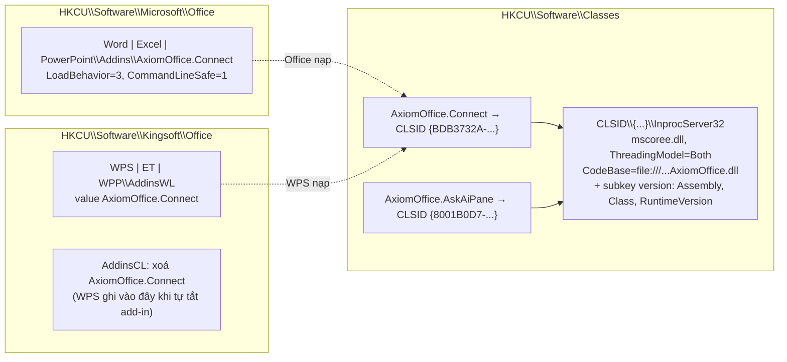

| Định danh | Giá trị |
|---|---|
| `AxiomOffice.Connect` | CLSID `{BDB3732A-A479-4A24-AD64-D35952035BBA}` |
| `AxiomOffice.AskAiPane` | CLSID `{8001B0D7-F189-443A-B3CB-6EB98038C72E}` |
| Assembly GUID | `5A8E1ED9-10D7-4231-9E7A-01D732C81467` |

`scripts/legacy.ps1` gỡ ProgID/CLSID/Addins/whitelist của tên cũ `WpsAiBridge` và chuyển cấu hình từ
`HKCU\Software\WpsAiBridge`, chỉ xoá khóa cũ sau khi đọc lại thấy khớp từng giá trị.

### 19.3 File runtime

| Đường dẫn | Nội dung |
|---|---|
| `%LOCALAPPDATA%\AxiomOffice\bridge.log` | Log chung add-in và Host, có `[pid N]` từng dòng |
| `%LOCALAPPDATA%\AxiomOffice\sessions\{pid}.json` | Session registry (mục 16); LibreOffice: `{pid}-{kind}.json`; WPS Linux: `<pid Core>-wps.json` |
| `%LOCALAPPDATA%\AxiomOffice\core.json` | Core đang chạy: `pid`, `port`, `version`, `protocol` (xoá khi Core thoát) |
| `%LOCALAPPDATA%\AxiomOffice\core.log` | Log của Core |
| `%LOCALAPPDATA%\AxiomOffice\core\core.db` | SQLite (WAL, schema 3): hội thoại, lượt chạy, audit, memory (mục 22.7) |
| `%LOCALAPPDATA%\AxiomOffice\skills\`, `mcp.json` | Skill của người dùng; cấu hình MCP server ngoài |

Trên Linux theo XDG: cấu hình `~/.config/axiom-office/config.json` (0600), dữ liệu
`~/.local/share/axiom-office/` (`core.db`, `skills/`, `mcp.json`, log), trạng thái sống
`$XDG_RUNTIME_DIR/axiom-office/` (`core.json`, `sessions/`).

## 20. Build, cài đặt, đóng gói

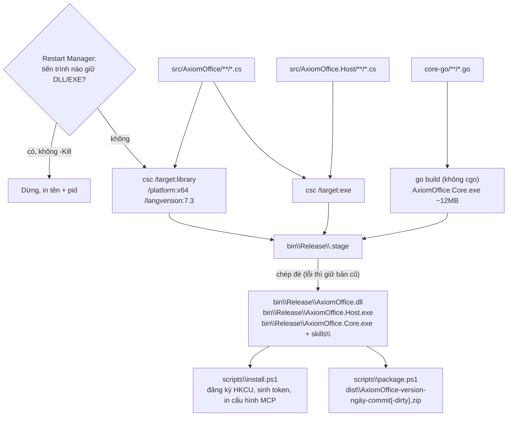

- **Build** (`scripts\build.ps1`): `csc` của VS 2022 Build Tools (hoặc csc của .NET Framework),
  `/codepage:65001`, chỉ tham chiếu assembly của framework. Hỏi Windows Restart Manager xem tiến
  trình nào đang giữ DLL/EXE (assembly .NET không hiện trong `Process.Modules`); `-Kill` tắt chúng.
  `AxiomOffice.csproj` gom `**\*.cs` giống script, chỉ để mở bằng IDE.
- **Cài** (`install.ps1` / `install.cmd`): gỡ Zone.Identifier, gỡ đăng ký cũ, ghi đăng ký (19.2),
  tạo `Port`/`PortOffice`/`Enabled`/`Token` nếu chưa có, in đoạn cấu hình MCP.
- **Gỡ** (`uninstall.ps1 [-Purge]`): gỡ mọi đăng ký (cả tên cũ); `-Purge` xoá cả cấu hình và log.
- **Gói** (`package.ps1 [-NoBuild] [-Kill] [-OutDir]`): DLL, EXE, script cài/gỡ, `legacy.ps1`,
  `install.cmd`/`uninstall.cmd`, `HUONG-DAN-CAI-DAT.txt`, `THIRD-PARTY-NOTICES.md`; entry zip dùng
  `/`; hậu tố `-dirty` khi code chưa commit.
- **Agent Core (Go)**: `build.ps1` tắt Core đang chạy (`/v1/admin/shutdown`), `go build`
  (cần Go 1.26+, không cgo nhờ `modernc.org/sqlite` nên build chéo được) thành
  `AxiomOffice.Core.exe` (~12MB sau `-s -w`) với version từ `VERSION`, chép `skills\` cạnh exe;
  thiếu Go thì bỏ qua Core (pane chạy in-process). Linux: `scripts/linux/package.sh` đóng tarball
  (`core/AxiomOffice.Core` ELF + `.oxt` + `wps-addin/`).
- Script `.ps1` giữ ASCII không BOM (PowerShell 5.1 đọc sai UTF-8 không BOM).

## 21. Thiết kế kiểm thử

| Bộ test | Chạy trên | Kiểm tra |
|---|---|---|
| `tests/live/test_live_commands.py` | Word/Excel/PowerPoint thật (`--wps`: WPS) | Mọi lệnh bridge và lỗi tham số; bảo mật HTTP (401/403/415); `--ai`: `ai.ask` thật trên 3 app, không tự lưu/xuất; offline: `office_action` từ chối lệnh ngoài danh sách (reflection vào DLL); `--record` / `--compare`: so kết quả từng lệnh với bản ghi golden |
| `tests/live/test_live_libreoffice.py` | LibreOffice thật (headless `--ui` có cửa sổ) | Mọi lệnh bridge LO như Office/WPS, hoàn tác cả lượt ở Writer/Calc/Impress, QA cấu trúc, `app.screenshot` |
| `tests/mcp-host/test_mcp_host.py` | Offline (+ live khi có app mở) | Giao thức MCP qua client chính thức; so kết quả tool với bản Python cũ trên cùng file; mở lại file Go ghi bằng python-docx / openpyxl / python-pptx; README khớp `commands --markdown` |
| `tests/mcp-host/test_mcp_portable.py` | Offline, 2 nền tảng, không cần thư viện ngoài | Giao thức + 50 tool + tool file + `.xls` + tool live khi có app mở (nhắm vào `Core mcp` hoặc `Host.exe mcp`) |
| `tests/mcp-host/oracle_diff.py` | Offline | Cùng kịch bản trên bản Go và bản C# cũ, so từng bước phát hiện lệch |
| `tests/mcp-host/office_roundtrip.ps1` | Office thật | File do Office tạo đọc được bằng Go và ngược lại |
| `tests/lo/test_extension.py`, `test_checks.py`, `test_chat.py` | Không cần LO / LO thật | Giải mã tham số, registry lệnh khớp bản C#, logic pane, QA checks |
| `tests/wps/` | Core + Node + WPS thật | Bridge WPS Linux e2e (35) + add-in Node (13+21+15) + live dưới Xvfb (24) |
| `core-go`: `go test ./...` | Offline, 2 nền tảng | Unit test 18+ gói (agent guard, codec, truncate, skills, memory, policy, MCP...) |
| `tests/core/test_core_e2e.py` (14 phần) | Core thật + LLM giả + bridge giả (`--office`: Excel thật; `--real-llm`: LLM thật) | SSE, hội thoại, allowlist, hủy, trần token, skill, memory 3 phiên + khởi động lại Core, xác nhận (đồng ý/từ chối/hết giờ), MCP (stdio + HTTP), QA thị giác, audit, setup, shutdown, Anthropic, embedding, tóm tắt |

- **Cách ly**: test live chỉ chạy trên app do chính nó mở; port đã có bridge của app người dùng
  thì dừng (test gọi `writer.closeAll`); chạy xong đóng app bằng WM_CLOSE, quá 20s mới kill.
- **Golden**: `--record` lưu kết quả từng lần gọi (đã bỏ pid, thời gian, thư mục tạm);
  `--compare` so các khóa có trong golden, khóa mới chỉ liệt kê. Dùng để chứng minh refactor không
  đổi hành vi.
- **Độ phủ**: test đọc `commands --json`; lệnh nào trong registry chưa được gọi thì báo lỗi.

## 22. Agent Core (bản Go: `core-go/`)

Đặc tả đầy đủ và lý do từng lựa chọn: [docs/architecture/core.md](core.md) (thiết kế ban đầu cho bản .NET);
bản Go giữ nguyên hợp đồng ngoài (Core API v1, `core.json`, `core.db` schema 3, nguồn cấu hình,
tên mutex) nên add-in/extension/MCP không phải đổi gì. Chi tiết cài đặt Go:
[core-go/README.md](../../core-go/README.md). Mục này mô tả bản Go đang chạy.

### 22.1 Process, tìm Core, bảo mật

- `cmd/axiom-core/main.go` đọc cấu hình (`internal/config`: `AXIOM_*` → HKCU / `config.json` →
  mặc định), giữ mutex một bản mỗi người dùng (Windows: `Local\AxiomOffice.Core`; Linux: `flock`
  trong `$XDG_RUNTIME_DIR/axiom-office`), mở HTTP server trên `127.0.0.1:47840` (**giữ luôn
  listener đã bind được**, bận thì thử 47841–47849), ghi `core.json` khi sẵn sàng. Subcommand `mcp`
  được chặn trước mutex (Core tự sinh tiến trình con bằng chính binary của nó).
- `internal/api/guard.go`: chặn request có `Origin` (403), thiếu/sai `X-Auth-Token` (401, dùng chung
  token với bridge), body không phải JSON (415). `/health` không cần token. Dừng êm khi nhận
  SIGTERM; khi shutdown thì **hủy lượt đang chạy trước khi đóng HTTP server** để pane còn nhận
  được `run.cancelled`.
- Log `core.log`: khởi động/thoát, mỗi lượt (vòng, tool call, token billable/raw/cache, thời gian,
  self-verified), lỗi provider, memory, MCP.

### 22.2 API (v1)

| Method | Path | Mô tả |
|---|---|---|
| `GET` | `/health` | `pid`, `port`, `version`, `protocol`, `memory` (`on`/`off`/`unavailable`) |
| `POST` | `/v1/runs` | Bắt đầu lượt chạy → `runId`, `conversationId` (chờ tối đa 10s để có hội thoại); `options.interactive=false` cho `ai.ask`, `options.mode="plan"` cho plan mode |
| `GET` | `/v1/runs/{id}` · `/events` | Kết quả · SSE (kết nối lại được với `?after=` hoặc `Last-Event-ID`) |
| `POST` | `/v1/runs/{id}/cancel` · `/confirm` | Hủy · trả lời xác nhận `{confirmationId, approved}` |
| `GET/DELETE` | `/v1/conversations[/{id}]` | Hội thoại theo tài liệu (`?documentKey=`) |
| `GET/POST` | `/v1/skills` · `/v1/skills/reload` | Skill theo app + lỗi nạp · quét lại |
| `GET/POST/PATCH/DELETE` | `/v1/memory[/{id}]`, `/restore`, `/history` | Ghi nhớ (người dùng); `?scope=` cho xoá theo phạm vi |
| `GET` | `/v1/audit?runId=&limit=` | Nhật ký tool call |
| `GET` | `/v1/mcp` | MCP server: tool, tin cậy, lỗi khởi động |
| `GET/POST` | `/v1/setup`, `/v1/llm/test`, `/v1/llm/models` | Wizard thiết lập (câu chữ từ `catalog/setup.json`): kiểm tra máy, thử kết nối, tải model |
| `POST` | `/v1/admin/shutdown` | Thoát êm |
| `*` | `/wps/...` | Kênh song song cho add-in WPS Linux (runs, events, confirm...) — xem `internal/api/wps.go` |

Sự kiện SSE: `run.started` (kèm `mode`), `skill.loaded`, `tool.started`, `tool.finished` (kèm
`resultBytes`), `confirm.required`, `run.reasoning` (khi bật `LlmShowReasoning`),
`run.reasoning.live` + `run.progress` (trạng thái đang tới), `run.model_switched`,
`memory.written`, `run.completed` (kèm `billableTokens`, `verified`, `model`) / `failed` /
`cancelled` / `timedout` / `stopped` (hết ngân sách), `ping`.

### 22.3 Một lượt chạy (`internal/agent/orchestrator.go`)

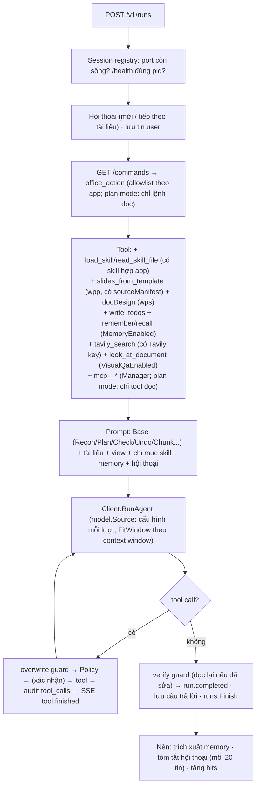

- Một lượt đang chạy cho mỗi port; **không trần thời gian mặc định** (`DefaultMaxSeconds = 0`;
  kiểm soát bằng `DefaultMaxRounds = 100` + nút Dừng; bên gọi vẫn đặt `maxSeconds`/`maxTokens` được).
- `ContextAssembler`: các lượt gần nhất trong ngân sách, vượt mốc 20 tin thì tóm tắt bằng LLM.
- Vòng `RunAgent` (`internal/model/agent.go`) chỉ gọi model → chạy tool → hỏi chuỗi guard
  (`internal/model/guards.go`, 4 móc `onReply/beforeCall/afterTools/recover`): trả lời rỗng (nhắc 1 lần),
  tự kiểm chứng, chặn lệnh y hệt (lần thứ 5), `write_todos` một lần/reply, tool báo xong (`Final`) thì
  kết thúc ngay, app sập (`Abort`) thì dừng, dọn ngữ cảnh (> 40k token, giữ 3 kết quả gần nhất),
  lặp một lỗi (3 lần y hệt thì dừng), ngân sách 3 mức (80% nhắc tiết kiệm, 90% tắt tool, 100% dừng),
  provider không hỗ trợ tool, tràn cửa sổ ngữ cảnh (dọn mạnh giữ 1, thử lại tối đa 2 lần),
  model dự phòng (trừ lỗi cấu hình 400/401).

### 22.4 Model gateway (`internal/model/`)

- Codec `openai.go` (`/chat/completions`, tool `function`, kết quả `role=tool`, ảnh gửi bằng
  tin `user` `image_url`) và `anthropic.go` (`/messages`, `tool_use`/`tool_result`, ảnh là khối `image`,
  prompt caching cho phần system ổn định). Tin assistant gửi lại nguyên văn. Quy tắc nối endpoint
  giống bản in-process (không nối lặp hậu tố).
- `max_tokens` mặc định 65536 mỗi phản hồi (model reasoning đốt vào phần suy nghĩ trước khi viết tool
  call nên 4096 hay chết `finish_reason=length`); `FitWindow()` hạ ngưỡng theo cửa sổ ngữ cảnh khi
  provider khai (`GET /models`) hoặc `LlmContextWindow` (Ollama/LM Studio) — không nâng ngưỡng cho
  model cửa sổ lớn.
- Lỗi tạm thời (429/5xx/rớt mạng) → thử lại 3 lần (1s→2s→4s, theo `Retry-After`); hỏng mà thử lại
  không qua (402/403/404/408/409/429, 5xx, mất kết nối, trả lời rỗng) → chuyển model dự phòng
  (`LlmFallbackModels`, sự kiện `run.model_switched`); 400/401 (lỗi cấu hình) không chuyển.
  Tràn cửa sổ ngữ cảnh → dọn mạnh rồi gọi lại (tối đa 2 lần/lượt).
- Trả lời rỗng giữa chừng → nhắc một lần (bị cắt `finish_reason=length` thì nhắc viết gọn lại một lần);
  `<thought>`/`<think>` bị lọc khỏi câu trả lời cuối. Token billable = input − cache + output.
- `model.Source`: đọc lại cấu hình LLM mỗi lượt, cache client khi không đổi; nhớ provider đã từ chối
  `thinking` để không gửi lại.

### 22.5 Tool registry (`internal/tools/`, `ITool` + `Registry`)

| Tool | Nguồn | Ghi chú |
|---|---|---|
| `office_action` | `/commands` của bridge | Allowlist `agent=true` theo app; sửa tên lệnh viết sai nhẹ; alias `cell_range→range`; params chuỗi JSON hỏng thì báo rõ; guard chống ghi đè + policy trước khi gọi; cắt response đọc lớn trước khi vào turns |
| `load_skill` / `read_skill_file` | `SkillIndex` | Tầng 2/3 của Agent Skills; chặn `..`, symlink, phần mở rộng lạ; ≤ 64KB; file nhị phân trả đường dẫn tuyệt đối (dùng với `writer.open`) |
| `remember` / `recall` | `MemoryService` | Chỉ ADD qua bộ chống trùng; phát `memory.written` (plan mode bỏ `remember`) |
| `write_todos` | built-in | Danh sách việc cho task ≥ 3 bước (không có trong plan mode; một lần mỗi reply) |
| `slides_from_template` | built-in | Dựng lại cả bài theo mẫu theo lô 25 slide (chỉ PowerPoint có `sourceManifest`; báo `Final` để kết thúc ngay khi xong) |
| `look_at_document` | bridge `app.screenshot` | Chỉ khi `VisualQaEnabled`; ảnh gửi cho model, không vào audit |
| `tavily_search` | Tavily REST | Chỉ khi `TavilyEnabled` và có `TavilyApiKey`; có cả trong plan mode (chỉ đọc web) |
| `mcp__<server>__<tool>` | `Manager` + `WrapMCPTools` | Server ngoài cần xác nhận trừ khi `trusted`; làn file `office` hỏi khi ghi vào file đã có (plan mode chỉ còn tool đọc) |

### 22.6 Skills (`internal/skills/`)

- Nguồn (sau thắng trước khi trùng tên): `skills\` cạnh exe → `SkillDirs` → `%LOCALAPPDATA%\AxiomOffice\skills`
  (Linux: `~/.local/share/axiom-office/...`); thư mục `_*` là gói tài nguyên dùng chung
  (vd `_design/tokens.json`). Quét lại theo nhịp 2s (`Watch`) + `POST /v1/skills/reload`.
- `loader.go` validate frontmatter theo chuẩn (tên ≤ 64 `a-z0-9-`, không `anthropic`/`claude`; mô tả
  ≤ 1024, không thẻ XML, ngôi thứ ba + từ khoá tiếng Việt; field lạ bỏ qua; `apps` tuỳ chọn).
  Lỗi → bỏ skill đó, hiện ở `/v1/skills`. Chỉ mục tầng 1 cắt ở 300 rune (`skillDescriptionLimit`).
- Skill dựng sẵn: tầng thiết kế (`thiet-ke-van-phong`, `trinh-bay-chuyen-nghiep`, `the-thuc-van-ban`,
  `bao-cao-du-lieu`) và tầng triển khai (`bao-cao-thang`, `bang-diem`, `mo-hinh-nhieu-sheet`,
  `van-ban-hanh-chinh`); checklist kết thúc bằng lệnh QA cấu trúc `wpp.checkLayout` /
  `et.checkRange` / `writer.checkTables`. Không chạy script trong skill.

### 22.7 Memory dài hạn (`internal/memory/` + `internal/store/`)

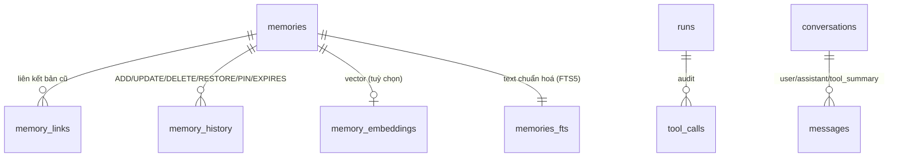

- Schema 2 (`PRAGMA user_version`); migration lỗi → memory `unavailable`, Core vẫn chạy agent.
- Phạm vi `user` (mọi tài liệu) và `document` (một file đã lưu; `document_key` chỉ chuẩn hoá case/`\`
  trên Windows). Chuẩn hoá bỏ dấu bằng bảng tiếng Việt tường minh (giống bản .NET), hash SHA-256
  chống trùng trong lô và với memory cũ, gần-trùng bằng cosine ≥ 0.96 khi có vector.
- **Ghi**: người dùng (API/form, `source=user`, confidence 1), tool `remember`, trích xuất nền sau
  lượt `completed` (prompt `prompts/extract.txt` nhúng bằng `go:embed`; bỏ qua lệnh thao tác thuần;
  id tạm chống bịa id; lọc confidence < 0,6, > 300 ký tự, thông tin nhạy cảm). Model chỉ ADD;
  ghi song song có retry khi SQLite bận. Xung đột xử lý lúc đọc: bản mới ghi rõ chuyển đổi và
  liên kết bản cũ, bằng điểm thì bản mới trước.
- **Đọc** (`retriever.go`): keyword (FTS5 `unicode61 remove_diacritics` + số từ khớp, sigmoid theo
  độ dài truy vấn) + thực thể (0,5 giảm theo độ phổ biến) + semantic nếu có embedding; ngưỡng 0,1
  chặn tín hiệu chính; ngữ cảnh = ghim + ≤ 20 memory tài liệu + ≤ 8 memory user, ≤ ~1.500 token.

### 22.8 Policy và xác nhận (`internal/policy/` + `internal/agent/confirm.go`)

`policy.Evaluate` cho `office_action`: lưu/xuất khi prompt không có ý lưu/xuất (parser mệnh đề
tiếng Việt/Anh, trừ từ ghép và phủ định); `saveAs`/`exportPdf` ghi đè file đã có; `wpp.deleteSlide`;
`writer.replaceAll`/`replaceMany` khi tài liệu > 20.000 ký tự. Thêm guard chống ghi đè
(`tools/overwrite.go`): ghi vào ô sheet đã có dữ liệu từ trước thì hỏi. `ConfirmationBroker`
(mỗi run) phát `confirm.required`, chờ `/confirm` tối đa `ConfirmTimeoutSeconds`; hết giờ/hủy =
từ chối; lượt `interactive=false` từ chối ngay. Mọi tool call vào audit (`tool_calls`).

### 22.9 MCP client (`internal/mcp/`)

- `Manager` đọc `mcp.json` (`{"mcpServers": {name: {command, args, env | url, headers, trusted, disabled, role}}}`)
  cộng server built-in `office` = `AxiomOffice.Core mcp` (Windows: `Host.exe mcp`; Linux: chính binary
  Core — tin cậy, **chỉ tool làn file**; tool live bị lọc vì đi vòng allowlist/policy). Khởi động
  lười ở lượt đầu, timeout 20s, lỗi → ẩn tool + log; `mcp.json` đổi → nạp lại ở lượt sau.
  Riêng `role: "web-search"` là đánh dấu của add-in (Core bỏ qua): server nằm trong menu **Tìm web**
  trên ribbon, cạnh nguồn Tavily tích hợp — chọn nguồn nào thì add-in tắt các nguồn còn lại.
- Transport: stdio (JSON-RPC mỗi dòng) và Streamable HTTP (JSON hoặc SSE, giữ `Mcp-Session-Id`).

### 22.10 QA hai mức

- **Cấu trúc** (luôn có, lệnh bridge chỉ đọc): `wpp.checkLayout` (tràn khung, ra ngoài slide, chồng
  shape, chữ < 12pt, slide quá nhiều chữ), `et.checkRange` (tiêu đề trống, kiểu lẫn lộn, số dạng chữ,
  thiếu number format, ô lỗi, dữ liệu lạc ngoài bảng; response lớn được cắt gọn giữ `issueCount`),
  `writer.checkTables` (ô trống, ô tiêu đề lẫn đoạn văn; bảng dàn trang gắn tem thì miễn `empty-cells`).
- **Thị giác** (tuỳ chọn): PowerPoint xuất thẳng slide đang mở (`Slide.Export`), Word/Excel chụp cửa
  sổ (`PrintWindow`), thu nhỏ ≤ 1280px → `look_at_document`.

### 22.11 Tích hợp add-in (`Ai/CoreClient.cs`, `CoreAdmin.cs`)

- `CoreClient.Run`: `EnsureBaseUrl` (đọc `core.json`, `/health`, khởi động exe nếu cần) → `POST /v1/runs`
  (gửi pid của bridge theo session file, kèm `document.view` + tệp đính kèm) → đọc SSE tới sự kiện
  kết thúc. **Chỉ trả null (dự phòng in-process) khi Core chưa nhận lượt chạy**; mọi lý do dự phòng
  ghi `bridge.log`.
- Pane hiện dòng tiến trình (`look_at_document`/`recall`/tool MCP đều có dòng riêng; `load_skill`/
  `remember` đã có dòng riêng nên ẩn), "Dùng kỹ năng", thẻ xác nhận (đồng ý/từ chối, 120s), thẻ kế
  hoạch (plan mode), dòng "Đã ghi nhớ" + Xoá (kể cả memory trích xuất nền: hỏi lại
  `/v1/memory?runId=` sau 8s và 25s), "Hoàn tác lượt này" (Word qua `writer.undo` nhiều bước).

---

## Phụ lục: thuật ngữ

| Thuật ngữ | Nghĩa |
|---|---|
| **Bridge** | HTTP server loopback trong mỗi instance app (hoặc companion) |
| **`AppKind`** | Loại app logic: `wps` (Word/Writer), `et` (Excel/Spreadsheets), `wpp` (PowerPoint/Presentation) |
| **`family`** | `office` (Microsoft Office) hoặc `wps` (WPS Office) |
| **Lệnh (command / action)** | Một thao tác `POST /cmd`, vd `et.writeRange`; khai báo trong registry |
| **Registry lệnh** | `CommandDispatcher.Commands`: nguồn duy nhất về tên, loại app, tham số, handler của lệnh |
| **`ForAgent`** | Cờ cho phép agent của Ask AI gọi lệnh |
| **Làn live / làn file** | MCP tool thao tác app đang mở qua bridge / sửa file trên đĩa không cần app |
| **Companion** | `AxiomOffice.Host.exe word|excel|...`: tự mở app qua COM và chạy bridge, không cần add-in |
| **CTP** | Custom Task Pane: pane dock của Office/WPS |
| **`ComGate`** | Cổng tuần tự hoá mọi truy cập COM của add-in |
| **Golden** | Bản ghi kết quả từng lệnh dùng để so trước/sau refactor |
| **Agent Core** | `AxiomOffice.Core.exe`: process riêng chạy agent cho mọi app (mục 22) |
| **Run / lượt chạy** | Một yêu cầu của người dùng tới lúc có câu trả lời; có `runId`, SSE, audit |
| **Skill** | Thư mục theo chuẩn Agent Skills (`SKILL.md` + tài nguyên), nạp khi yêu cầu khớp |
| **Memory** | Ghi nhớ dài hạn (`user` / `document`), model chỉ thêm, người dùng sửa/xoá |
| **Xác nhận (policy)** | Thẻ Đồng ý / Từ chối trước thao tác rủi ro; hết giờ = từ chối |
| **QA cấu trúc / thị giác** | Soát lỗi trình bày bằng số liệu đọc lại / bằng ảnh chụp cửa sổ |
