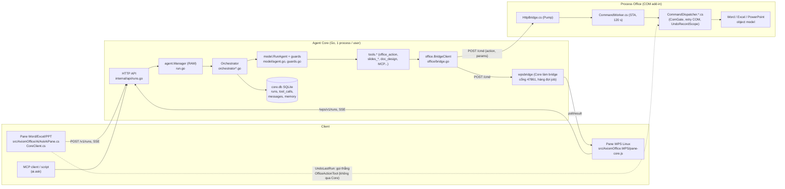
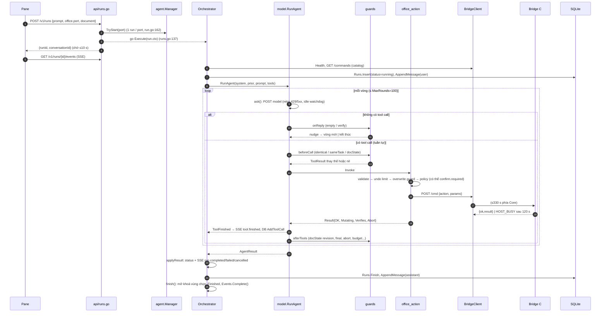
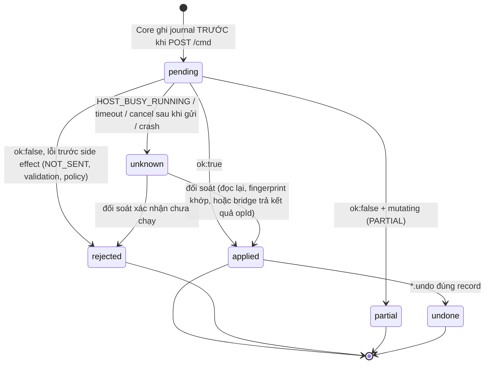
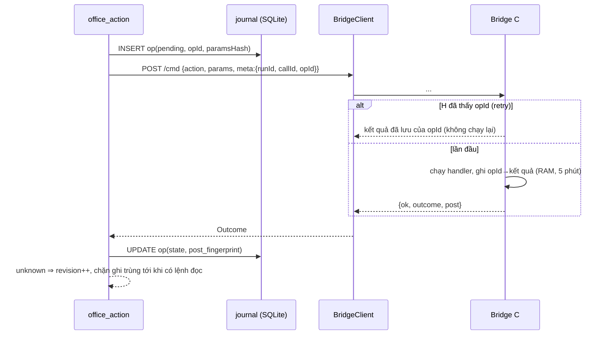

# Audit kỹ thuật chuyên sâu: Agent Runtime của Axiom Office

Ngày audit: **26/10/2026** · nhánh `claude/inspiring-davinci-1fxpeg` (HEAD `2eb6718`) · phạm vi: Agent Core Go
(`core-go/`), bridge C# cho Microsoft Office (`src/AxiomOffice/Bridge`, `src/AxiomOffice/Ai`), kênh WPS Linux
(`core-go/internal/wpsbridge`, `src/AxiomOffice.WPS`). LibreOffice đã dừng hỗ trợ (STATUS.md §1) nên chỉ được nhắc
khi cần.

Đây là báo cáo audit, **không** sửa mã nguồn. Mọi số dòng dưới đây đọc trực tiếp từ HEAD nói trên. Những gì chưa
chạy được trong môi trường audit (Linux, không có Office/WPS) được ghi rõ ở Phần I.

Quy ước trạng thái trong báo cáo:

| Ký hiệu | Nghĩa |
|---|---|
| **TEST** | Đã triển khai và có test xác minh (đã chạy trong audit này) |
| **IMPL** | Đã triển khai, kiểm thử chưa đầy đủ |
| **PART** | Triển khai một phần |
| **DOC** | Chỉ được mô tả trong tài liệu |
| **NONE** | Đã xác minh là chưa có |
| **?** | Chưa đủ bằng chứng |

---

## Phần A — Executive Summary

### Đánh giá tổng thể

Axiom có một **agent loop có quản lý trạng thái trong bộ nhớ** (không phải workflow engine, cũng không phải durable
runtime). Vòng lặp được gia cố rất kỹ bằng một chuỗi *guard* có test (chặn lặp, ngân sách, tự kiểm chứng, model dự
phòng, dọn ngữ cảnh, chặn undo quá phạm vi lượt...), và mọi guard đều xuất phát từ sự cố đo được trên lượt chạy thật
— đó là điểm mạnh rõ rệt của codebase. Run lifecycle tách khỏi kết nối SSE và hủy được an toàn ở phía Core.

Điểm yếu nằm ở **ranh giới side effect với Office**: giao thức bridge không có operation ID, không phân biệt được
"chưa chạy" với "có thể đã chạy" ở tầng Core (trừ kênh WPS Linux, và chỉ bằng câu chữ), không có nhật ký thao tác
trước khi thực thi, và mọi trạng thái của lượt nằm trong RAM. Hệ quả là các đảm bảo về **không chạy trùng**, **phục hồi
sau crash** và **hoàn tác đúng phạm vi** chỉ đúng trong điều kiện bình thường, không đúng dưới lỗi.

### Năng lực đã xác minh (có test chạy được trong audit)

- Vòng lặp model ↔ tool với 15 guard (`core-go/internal/model/guards.go:90-122`), phần lớn guard có unit test riêng (`agent_guard_test.go`, `agent_verify_test.go`, `fallback_test.go`, `sametask_test.go`).
- Run tách khỏi SSE: run chạy trên `context.Background()` riêng (`internal/agent/run.go:67-74`); SSE có `id:` và
  phát lại theo `?after=`/`Last-Event-ID` (`internal/api/runs.go:221-312`).
- Hủy lượt (`POST /v1/runs/{id}/cancel`) dừng agent, không gửi lệnh mới xuống bridge — e2e `test_cancel` PASS.
- Giới hạn undo trong phạm vi lượt ở Core (`internal/tools/undo.go:42-77`) — `TestUndoLimitedToThisRun` PASS.
- Hỏi trước khi ghi đè ô có sẵn, xoá slide, lưu file ngoài yêu cầu (`internal/tools/overwrite.go:596`,
  `internal/policy/policy.go:115-156`) — test PASS.
- e2e Core thật + bridge/LLM giả: **170/170**; e2e kênh WPS: **36/36** và **94/94**.

### Lỗ hổng đáng quan tâm nhất

| ID | Mức | Tóm tắt |
|---|---|---|
| F01 | High | Kết quả mơ hồ (`HOST_BUSY` sau 120 s, timeout, hủy giữa lệnh) được báo là *thất bại* dù lệnh có thể đã chạy xong trong Office; model có thể gọi lại → **chèn trùng**. Không có operation ID / idempotency. |
| F02 | High | "Hoàn tác lượt này" của pane Word đếm số lệnh ghi thành công nhưng **không trừ các lần agent đã tự `writer.undo`**, và gọi thẳng bridge (bỏ qua giới hạn của Core) → lùi vào nội dung có từ trước lượt. |
| F03 | High | `writer.undo` lùi đỉnh ngăn undo của Word bất kể ai tạo; người dùng gõ xen giữa thì undo của agent/pane lùi **việc của người dùng**. Core không phát hiện được. |
| F04 | High | Không có durable execution: trạng thái lượt chỉ trong RAM, không có nhật ký trước khi thực thi, không đối soát lượt `running` khi khởi động lại; crash giữa lệnh ghi để lại tài liệu sửa dở **không có bản ghi nào**. |
| F05 | Medium | Bridge C# thử lại *toàn bộ* handler khi COM từ chối cuộc gọi (`RPC_E_CALL_REJECTED`...), kể cả handler nhiều bước đã gây side effect một phần. |
| F06 | Medium | Cờ `verified` chỉ có nghĩa "agent đã được buộc/đã đọc lại", không phải "trạng thái tài liệu đã được kiểm đúng". |
| F07 | Medium | `make test-go` (đích CI, có `-race`) **thất bại 3/3 lần** vì data race trong test `internal/model/resume_test.go`. |

### Có nên xây workflow engine?

**Không xây workflow engine tổng quát lúc này.** Các lỗ hổng ở trên không do thiếu đồ thị bước/rẽ nhánh mà do thiếu
**hợp đồng side effect** ở ranh giới Core ↔ bridge. Khuyến nghị: một *operation journal* nhỏ trong SQLite + operation
ID trong giao thức `/cmd` + đối soát khi khởi động (Phần H). Đó là phần của "workflow engine" mà Axiom thực sự cần;
phần còn lại (DAG, subworkflow, song song) chưa có nhu cầu nào trong code hay benchmark.

### Có nên thử LangGraph?

**Không, ở thời điểm này.** LangGraph checkpoint trạng thái *đồ thị* của nó; nó không biết Word đã chèn đoạn văn hay
chưa. Đặt nó trước Core sẽ thêm một runtime Python, một ranh giới trạng thái thứ hai cần đồng bộ, và vẫn phải tự xây
đúng những thứ còn thiếu (operation ID, đối soát side effect). Điều kiện để xem lại: Phần F.

---

## Phần B — Architecture Map

### B.1 Sơ đồ thành phần



### B.2 Nơi lưu trạng thái và nơi phát sinh side effect

| Trạng thái | Nơi lưu | Bền qua restart? | Bằng chứng |
|---|---|---|---|
| Trạng thái run (status, reply, tokens, transcript) | RAM `agent.Run` | Không | `run.go:32-65` |
| Buffer sự kiện SSE (1.000 sự kiện) | RAM `EventStream` | Không | `events.go:17-44` |
| Lịch sử model trong lượt (`loop.turns`), revision tài liệu, đếm guard | RAM `agentLoop` | Không | `guards.go:58-75` |
| Đếm undo của lượt, ô đã ghi, đối tượng do lượt tạo, tài liệu đích | RAM `tools.RunContext` | Không | `tools/tools.go:72-...` |
| Xác nhận đang chờ | RAM `Confirmations` | Không | `confirm.go:15-18` |
| Dòng `runs` (status khi bắt đầu/kết thúc) | SQLite | Có | `store/runs.go:39-54` |
| Audit tool call (**sau** khi tool xong) | SQLite `tool_calls` | Có | `orchestrator_execution.go:365`, `store/runs.go:58-63` |
| Tin nhắn hội thoại (user, `tool_summary`, assistant) | SQLite `messages` | Có | `orchestrator_execution.go:120, 372-374, 396` |
| Nội dung tài liệu | Ứng dụng Office (chưa lưu đĩa trừ khi `*.save`) | Theo Office | — |

Side effect chỉ phát sinh ở một chỗ trong Core cho lệnh live: `BridgeClient.Command` (`office/bridge.go:104`), được
gọi từ `office_action.Invoke` (`tools/office_action.go:261`) và từ các tool ghép (`slides_from_brief`,
`slides_from_template`, `doc_design`). Ngoài Core còn một đường thứ hai: nút "Hoàn tác lượt này" của pane gọi thẳng
`OfficeActionTool.Execute` trong add-in (`AskAiPane.cs:1083-1105`).

### B.3 Sequence — luồng 1: một lượt chạy từ yêu cầu đến hoàn tất



### B.4 Sequence — luồng 2: một thao tác chỉnh sửa Word (`writer.appendText`)

```mermaid
sequenceDiagram
  participant L as RunAgent
  participant T as OfficeActionTool.Invoke
  participant B as BridgeClient.send
  participant HB as HttpBridge (Pump)
  participant CW as CommandWorker
  participant CD as CommandDispatcher.Execute
  participant W as Word
  L->>T: {"action":"writer.appendText","params":{...}}
  T->>T: CanonicalAction, allowlist, normalizeParamsChecked, aliasParams, withTarget(document)
  T->>B: Command(port, action, params)  — không có run/op ID
  B->>HB: POST /cmd
  HB->>CW: Run(job, 120 s)
  CW->>CD: Execute (ComGate.Run, retry COM tối đa 10 lần)
  CD->>CD: ActivateTarget, RequireKind, RunInSelectionLock
  CD->>W: UndoRecord.StartCustomRecord("AI: append text")
  CD->>W: Content.InsertAfter("\r"), InsertAfter(text), format
  CD->>W: EndCustomRecord
  CD-->>CW: {ok:true,result:{appended,paragraphs}}
  alt quá 120 s
    CW-->>HB: HOST_BUSY ... (lệnh VẪN chạy tiếp trong Word)
  end
  HB-->>B: JSON
  B-->>T: BridgeResult
  T-->>L: Mutating = OK && ChangesDocument && !unchanged ; countUndoable
```

### B.5 Sequence — luồng 3: hủy / mất SSE / Core dừng

```mermaid
sequenceDiagram
  participant P as Pane
  participant A as API
  participant R as Run (ctx)
  participant L as RunAgent
  participant B as BridgeClient
  participant H as Office
  Note over P,A: Mất SSE: streamEvents thoát theo r.Context(); run KHÔNG bị hủy
  P--xA: TCP đóng
  Note over P: Pane Windows báo "mất kết nối", không kết nối lại (CoreClient.cs ~556-571)
  P->>A: POST /cancel
  A->>R: Manager.Cancel → ctx cancel
  R-->>B: http request bị huỷ
  B-->>L: {"ok":false,"error":"cancelled"}
  H->>H: lệnh COM đang chạy KHÔNG huỷ được, có thể hoàn tất
  L->>L: vòng kế: runCtx.Err() → stopped() → Cancelled
  L-->>A: run.cancelled (không ghi "lệnh cuối có thể đã chạy")
  Note over A: Core stop: CancelRunning() → Shutdown; Serve xong thì chờ ≤ 2 s (main.go:170-187, 229-233)
```

---

## Phần C — Capability Matrix

| Năng lực | Implementation | Test evidence | Trạng thái | Rủi ro | Khuyến nghị |
|---|---|---|---|---|---|
| Vòng lặp model ↔ tool | `model/agent.go:191-356` | `agent_verify_test.go`, `agent_guard_test.go`, e2e `fake_bridge` | TEST | Thấp | Giữ |
| Nhiều tool call / lượt | Chạy **tuần tự** theo thứ tự model trả (`agent.go:315-340`) | `TestOncePerReplyBlocksSecondCall` | TEST | Thấp; không có song song (không cần) | Giữ tuần tự |
| Giới hạn vòng | `MaxRounds` mặc định 100, kẹp 1..1000 (`orchestrator.go:59-60, 95`) | `TestParseRequestValidatesAndClamps` | TEST | Thấp | — |
| Timeout lượt | Mặc định **không** có (`DefaultMaxSeconds=0`); `maxSeconds` tuỳ chọn (`agent.go:220-225`) | `TestRunAgentEnforcesDeadline` | TEST | Thấp (có idle watchdog + MaxRounds) | — |
| Timeout model | Idle watchdog (không có byte) `model/idle.go`; phát hiện máy ngủ `resume.go` | `sse_test.go`, `resume_test.go` (**race khi -race**) | PART | Trung bình (test CI đỏ, F07) | Sửa test |
| Retry model | 429/500/502/503/504 + lỗi transport, `Retry-After` (`client.go:200-268`) | `model_test.go` | TEST | Thấp | — |
| Model dự phòng | `fallbackGuard` (`guards.go:690-735`) | `TestRunAgentSwitchesToFallbackModel` | TEST | Thấp | — |
| Phản hồi model không hợp lệ | `emptyReplyGuard`, `repairToolCall`, `unknownToolMessage`, params JSON hỏng (`office_action.go:378-405`) | `repair_test.go`, `TestRunAgentRecoversFromTruncatedReply` | TEST | Thấp | — |
| Chống lặp vô hạn | `identicalCallGuard`, `sameTaskGuard`, `repeatedFailureGuard`, `heavyRunGuard` | `agent_guard_test.go`, `sametask_test.go` | TEST | Thấp | — |
| Phân loại lỗi retry/không retry | Model: có (`IsTransient`, `switchable`). Tool/bridge: **không** (model tự quyết) | — | PART | **Cao** (F01) | Phân loại kết quả bridge |
| State machine run | Hằng chuỗi + nhánh; chỉ goroutine Execute ghi; `Manager.Cancel` kiểm `running` (`run.go:15-22, 182-191`) | `TestManagerBusyAndCancel`, `TestRunReadableWhileExecuteWrites` (-race PASS) | IMPL | Thấp (xem C.1) | Không cần FSM tường minh |
| 1 run / office port | `Manager.TryStart` dưới mutex (`run.go:162-174`) | `TestManagerBusyAndCancel` | TEST | Thấp | — |
| Run độc lập SSE | `newRun` dùng `context.Background()` (`run.go:68`); SSE chỉ đọc buffer | e2e `cancel`, unit `TestEventStreamPublishWaitAndReplay` | TEST | Thấp | — |
| Replay SSE | `id:` + `?after=`/`Last-Event-ID` (`runs.go:276, 302-312`), buffer 1.000 (`events.go:17`) | Unit `TestEventStreamPublishWaitAndReplay`; **không** có e2e reconnect | IMPL | Thấp | e2e reconnect |
| Pane kết nối lại SSE | Windows: **không** (`CoreClient.cs:469-571`). WPS: `EventSource` (trình duyệt tự kết nối lại; Core nhận `Last-Event-ID`) | Không | PART / ? | Trung bình (F09) | Reconnect với `after=` |
| Hủy lượt | `Manager.Cancel` → ctx (`run.go:182`); kiểm trước mỗi vòng và mỗi tool call (`agent.go:250, 316`) | e2e `test_cancel` PASS | TEST | Trung bình: lệnh COM đang chạy không hủy được, không đánh dấu | Đánh dấu "có thể đã chạy" |
| Persistence run | SQLite `runs`/`tool_calls`/`run_rounds`; lỗi ghi bị bỏ qua (`store/runs.go:40, 50, 60, 73`) | `store` tests | PART | Trung bình (F08) | Log/đếm lỗi ghi |
| Durable execution / resume sau crash | Không có | — | NONE | **Cao** (F04) | Journal + đối soát |
| Checkpoint | Không có | — | NONE | Cao | Chỉ trước/sau side effect |
| Human approval | `confirm.required` → `/confirm`; hết giờ = từ chối (`confirm.go:64-107`); `interactive=false` = từ chối | `TestConfirmationsResolveAndTimeout`, e2e `confirm` | TEST | Thấp | — |
| Pause/resume lượt | Chỉ trong khi chờ xác nhận; không pause/resume tuỳ ý | — | NONE | Thấp (chưa cần) | Không làm |
| Kế hoạch (plan mode) | Lượt chỉ đọc trả kế hoạch; lượt sau trong cùng hội thoại thực hiện (`orchestrator.go:34-36`) | `TestParseRequestMode`, `plan_capabilities_test.go` | TEST | Thấp | — |
| Danh sách việc | `write_todos` (ghi đè cả danh sách) | `todo_test.go` | TEST | Thấp | — |
| Song song / DAG / subworkflow | Không có | — | NONE | — (không cần) | Không làm |
| Compensation | Chỉ qua `*.undo` do model chọn | — | PART | Cao (F02/F03) | Xem Phần H |
| Allowlist lệnh / schema | `action` là enum từ `GET /commands` (`office_action.go:132-151`); tham số bắt buộc **do bridge** kiểm | `office_action_schema_test.go`, `params_test.go` | TEST | Thấp | — |
| Chọn đúng tài liệu | Core gắn `document/workbook/presentation` (`tools/target.go`); bridge `ActivateTarget` | `target_test.go`; live test chưa chạy | IMPL | Trung bình (STATUS/plan 19 H1 còn live test) | — |
| Khoá vùng bôi đen | WPS: `writer.lockSelection` (`orchestrator.go:206-258`) | `TestParseRequestSelectionLock` | IMPL | Thấp | — |
| 1 tool call = 1 bước Ctrl+Z (Word) | `UndoRecordScope` trong từng handler `writer.*` (`CommandDispatcher.Params.cs:451-487`) | Live test `tests/live/test_live_commands.py:270-281` (**chưa chạy trong audit**) | IMPL / ? | Trung bình: im lặng bỏ qua nếu `UndoRecord` không có | Báo lỗi khi không mở được record |
| Ctrl+Z cho Excel | Ghi qua COM không vào ngăn undo; `et.undo` gọi `app.Undo()` (`Spreadsheet.cs:1081-1109`) | Live test chấp nhận `undone=0` (`test_live_commands.py:397-402`) | NONE (Excel) | Trung bình | Không quảng bá; ẩn `et.undo` trên Excel |
| Ctrl+Z cho PowerPoint | Không có `UndoRecord` (WPP), một tool call có thể ra nhiều bước | — | NONE | Trung bình | Ghi rõ giới hạn |
| Undo giới hạn trong lượt (Core) | `limitUndo`/`countUndoable` (`undo.go:42-77`) | `TestUndoLimitedToThisRun`, `TestMakesUndoStepMatchesCatalog` | TEST | Cao ở biên (F02, F03) | — |
| Idempotency / operation ID | Không có trong `/cmd` (`bridge.go:127-135`) | — | NONE | **Cao** (F01) | Thêm `opId` |
| Phân biệt "chưa gửi" và "có thể đã chạy" | WPS Linux: có, bằng câu chữ (`wpsbridge.go:283-296`); Windows: `HOST_BUSY` "still running" (`CommandWorker.cs:56-59`); Core: không dùng | `wpsbridge_test.go:272` | PART | Cao | Mã lỗi máy đọc được |
| Lệnh xếp hàng không chạy muộn | `CommandWorker` đánh dấu bỏ job chưa chạy (`CommandWorker.cs:50, 73-77`) | Chưa có test C# chạy trong audit | IMPL | Thấp | — |
| Verification lớp 1 (thực thi) | `ok` của bridge | e2e | TEST | Trung bình (kết quả mơ hồ) | — |
| Verification lớp 2 (trạng thái) | Model được buộc đọc lại (`verifyGuard`), lệnh `checkTables/checkRange/checkLayout` | `agent_verify_test.go`, e2e `verify` | PART | Trung bình (F06) | Kiểm có cấu trúc |
| Verification lớp 3 (yêu cầu) | Chỉ do LLM tự nhận định; benchmark ngoài luồng (`tests/bench/office`) | Bench có kết quả lưu (chưa chạy lại) | PART | Trung bình | — |
| Verification lớp 4 (cấu trúc tệp) | Không trong luồng live; bench có `check_docx` | — | PART | Thấp | — |
| Verification lớp 5 (thị giác) | `look_at_document` khi bật `VisualQaEnabled` | `visual_test.go`, e2e `visual` | IMPL | Thấp | — |
| Verification lớp 6 (lưu) | Không kiểm tệp sau `*.save` | — | NONE | Trung bình | Kiểm `fullName`/mtime |
| Audit tool call | `tool_calls` sau khi tool xong; params ≤ 2 KB | e2e | TEST | Trung bình (không có bản ghi "đang chạy") | — |
| Trace chi tiết | `DebugTrace` → `traces/<run>.jsonl` (0600), tắt mặc định (`trace.go:24-40`) | `TestRunTraceWritesJSONLines` | TEST | Thấp (nội dung nhạy cảm khi bật) | — |
| Token/chi phí | Token, cached, billable theo run và vòng (`run_rounds`) | `TestCachedTokensAreRead`, `TestBillableTokensIgnoresCache` | TEST | Thấp; không có quy đổi tiền | — |

### C.1 State machine của run: có cần tường minh không?

Trạng thái thực tế: `running` → một trong `completed | failed | cancelled | timedout | stopped` (`run.go:15-22`).

- **Ai ghi:** chỉ goroutine `Execute` ghi `Status` (qua `run.update`), ở đúng hai chỗ: `applyResult`
  (`orchestrator_execution.go:393-426`) và `fail` (`orchestrator.go:286-290`). API chỉ đọc (`CurrentStatus`,
  `JSON`) dưới mutex.
- **Quay lại running:** không có đường code nào gán `StatusRunning` sau `newRun` — không thể quay lại từ trạng thái
  terminal.
- **Hai yêu cầu cùng lúc:** `TryStart` giữ `Manager.mu` khi quét và chèn (`run.go:162-174`), nên hai `POST /v1/runs`
  cùng port không thể cùng chạy. Hai `cancel` cùng lúc: `context.CancelFunc` idempotent.
- **Race đã kiểm:** `go test -race ./internal/agent/` PASS, có `TestRunReadableWhileExecuteWrites`.
- **Biên nhỏ:** status chuyển terminal trong `applyResult` *trước* `finish()` mở khoá vùng chọn và đặt `Finished`
  (`orchestrator.go:196-197, 261-265`). Trong khoảng đó một lượt mới trên cùng port được `TryStart` chấp nhận trong khi
  khoá vùng chọn WPS của lượt cũ chưa được gỡ. Ảnh hưởng thấp (lượt mới gọi `lockSelection` lại).

Kết luận: thiếu FSM tường minh **chỉ là khác biệt tổ chức code**, không phải lỗi thực tế. Không khuyến nghị thêm FSM
cho run; chỉ cần khi thêm trạng thái mới (vd `interrupted` sau restart — Phần H).

---

## Phần D — Detailed Findings

### F01 — Kết quả mơ hồ bị coi là thất bại; không có idempotency → nguy cơ chèn trùng

**Mức độ:** High (sửa sai tài liệu; người dùng thấy và Ctrl+Z được ở Word, nhưng Excel/PowerPoint không có Ctrl+Z
cho thay đổi qua COM).

**Bằng chứng**

- `/cmd` chỉ mang `{action, params}` — không có run ID, call ID hay operation ID: `office/bridge.go:127-135`.
- Bridge C# trả `HOST_BUSY: the host has not finished '<action>' after 120 s (it is still running)` khi lệnh đang
  chạy vượt 120 s; lệnh **vẫn tiếp tục** chạy trong Office: `CommandWorker.cs:42-67` (comment dòng 12: "lệnh đang chạy
  dở không huỷ được (COM)").
- Core coi mọi `ok:false` là không sửa tài liệu: `Mutating: result.OK && ChangesDocument(action) && !unchanged`
  (`tools/office_action.go:301`); `countUndoable` chỉ đếm khi `mutating` (`undo.go:66-77`); `docStateGuard` không tăng
  `revision` (`guards.go:270-294`).
- Khi run bị hủy giữa lệnh, `send` trả `"cancelled"` (`bridge.go:221-224`), lượt kết thúc `cancelled` không kèm thông
  tin lệnh cuối có thể đã chạy (`orchestrator_execution.go:403-405`).
- Kênh WPS Linux làm tốt hơn: phân biệt `"... it was not sent, safe to retry"` với `"... the command may have been
  applied - check the document before retrying"` (`wpsbridge/wpsbridge.go:283-296`, test `wpsbridge_test.go:272`).
  Nhưng đó là câu chữ cho model, Core không xử lý khác đi.

**Cơ chế:** Office hoàn tất `writer.appendText` / `writer.insertTable` / `wpp.addSlide` sau mốc 120 s (vd hộp thoại
modal vừa đóng, tài liệu lớn) → model nhận lỗi → không có gì ngăn model gọi lại cùng lệnh → nội dung xuất hiện hai lần.
`identicalCallGuard` chỉ chặn từ lần thứ 5 (`DefaultMaxIdenticalCalls=4`, `agent.go:101`) nên không ngăn lần gọi lại thứ hai.

**Tác động phụ:** bước undo "mồ côi" không được đếm → `limitUndo` cho lùi ít hơn số bước thật; `revision` không tăng
→ một lệnh đọc trước đó có thể bị `docStateGuard` trả "unchanged" dù tài liệu đã đổi.

**Điều kiện tái hiện (mock):** bridge giả trả `{"ok":false,"error":"HOST_BUSY ... still running"}` cho
`writer.appendText` nhưng vẫn ghi vào trạng thái tài liệu giả; LLM giả gọi lại cùng lệnh; đếm số lần side effect.

**Khắc phục nhỏ nhất:** (1) phân loại kết quả bridge thành `ok | failed | unknown` (mã lỗi máy đọc được: `HOST_BUSY_RUNNING`,
`TIMEOUT_AFTER_SEND`, `CANCELLED_AFTER_SEND`, `NOT_SENT`); (2) `unknown` với lệnh ghi → coi là *có thể đã sửa*
(`revision++`, đánh dấu `verifiedAt` cũ) và trả model chỉ dẫn bắt buộc đọc lại trước khi làm tiếp; (3) giai đoạn sau:
`opId` trong `/cmd` + bảng op gần đây trong bridge (Phần H).

**Test sau sửa:** test Go với `httptest` bridge giả như trên: kết quả `unknown` → `Mutating=true` giả định, lệnh ghi
giống hệt kế tiếp bị chặn cho tới khi có lệnh đọc; side-effect count = 1.

### F02 — "Hoàn tác lượt này" (pane Word) có thể lùi vào nội dung có từ trước lượt

**Mức độ:** High (mất nội dung người dùng; Ctrl+Y có thể cứu nếu người dùng biết).

**Bằng chứng**

- Pane đếm mọi lệnh `writer.*` ghi thành công trong lượt: `_runEdits++` (`AskAiPane.cs:1045-1048`), `_lastRunEdits =
  _runEdits` khi lượt xong (`AskAiPane.cs:1127`). Không có chỗ nào trừ đi khi agent tự gọi `writer.undo` trong lượt
  (`writer.undo` không thuộc `WordEditActions`, `AskAiPane.cs:1053-1069`).
- `UndoLastRun` gọi `writer.undo {count:_lastRunEdits}` **thẳng vào add-in** qua `OfficeActionTool.Execute`
  (`AskAiPane.cs:1083-1105`), không đi qua `limitUndo` của Core.
- `WriterUndo` gọi `doc.Undo(1)` `count` lần, tăng `undone` kể cả khi Word trả `false` (không còn gì để lùi)
  (`CommandDispatcher.Writer.cs:916-945`).

**Cơ chế / tái hiện:** lượt chạy `appendText`, `appendText`, rồi agent tự `writer.undo {count:1}` (được Core cho phép,
`undo.go:42-63`) → trên ngăn undo còn 1 bước AI; pane đếm 2. Người dùng bấm "Hoàn tác lượt này" → `Undo` 2 lần → lùi
bước AI còn lại **và một bước của người dùng trước lượt**. Tương tự khi `doc_design` sửa tài liệu: các lệnh bridge của
nó không phát `tool.finished` với `action` `writer.*` nên pane đếm thiếu (an toàn hơn), còn chiều thừa xảy ra như trên.

**Khắc phục nhỏ nhất:** lấy số bước undo còn lại của lượt từ Core (Core đã có `run.undoable` — đưa vào
`run.completed`/`GET /v1/runs/{id}` hoặc thêm `POST /v1/runs/{id}/undo` dùng chính `limitUndo`), pane không tự đếm.

**Test sau sửa:** test Go: lượt có 2 ghi + 1 undo → số bước còn lại = 1; e2e: pane/endpoint undo gửi `count:1`.
Live test Word: seed nội dung, chạy kịch bản trên, kiểm nội dung seed còn nguyên.

### F03 — Undo theo ngăn undo của Word không phân biệt bước của agent với bước của người dùng

**Mức độ:** High (mất nội dung người dùng trong kịch bản đồng thời có thật: người dùng gõ khi agent đang chạy hoặc
giữa lượt và lúc bấm "Hoàn tác lượt này").

**Bằng chứng:** `WriterUndo` chỉ biết "lùi 1 bước" (`CommandDispatcher.Writer.cs:916-945`); bridge không đọc tên
record (`"AI: ..."`) trước khi lùi; Core chỉ biết số bước nó tạo (`undo.go:66-77`). Repo thừa nhận giới hạn tương tự
cho revision: "nguoi dung sua tay giua luot thi khong thay (gioi han da biet)" (`guards.go:248-249`).

**Khắc phục nhỏ nhất:** trước mỗi `Undo(1)`, đọc `Application.UndoRecord`/danh sách undo (Word có
`CommandBars("Standard").Controls("Undo")`/`Document.Undo` không cho tên; cần **thử nghiệm** khả thi trên Word thật) để
chỉ lùi khi đỉnh ngăn là record `"AI: ..."`. Nếu không đọc được tên record: dừng lùi khi phát hiện tài liệu đã đổi
ngoài agent (so `Content.End`/hash vùng nhỏ chụp sau lệnh ghi cuối của lượt).

**Phép thử thực tế đề xuất (Word):** (1) mở tài liệu seed 3 đoạn; (2) chạy lượt 2 lệnh ghi; (3) gõ tay "X";
(4) bấm "Hoàn tác lượt này"; (5) đo: "X" còn không, 3 đoạn seed còn không, 2 đoạn AI còn không. Kỳ vọng hiện tại theo
code: "X" bị mất và một đoạn AI còn lại.

### F04 — Không có durable execution; crash để lại tài liệu sửa dở không có bản ghi

**Mức độ:** High (khả năng phục hồi), không Critical vì người dùng đang nhìn tài liệu và Word/Excel có autosave/khôi
phục riêng.

**Bằng chứng**

- Toàn bộ trạng thái lượt trong RAM (Phần B.2).
- `tool_calls` chỉ được ghi **sau** khi tool xong (`orchestrator_execution.go:347-366`); không có bản ghi "bắt đầu lệnh
  X". Crash giữa `BridgeClient.Command` và `ToolFinished` = không có dấu vết lệnh đã gửi.
- Không có đoạn code nào đối soát dòng `runs.status='running'` khi khởi động (tìm `'running'` trong
  `core-go/internal`, `cmd`: chỉ thấy câu `INSERT` ở `store/runs.go:41`). Sau crash, dòng đó ở `running` mãi mãi.
- Khi dừng có kiểm soát: hủy lượt rồi chờ ≤ 2 s (`cmd/axiom-core/main.go:170-187, 229-233`) — tốt, nhưng không bao
  phủ crash/kill.
- Lịch sử hội thoại lưu được (`messages`), nhưng đó là văn bản tóm tắt (`tool_summary "label (ok)"`), không phải trạng
  thái thực thi; không thể resume lượt từ đó.

**Tác động:** sau crash/kill, người dùng gửi lại yêu cầu → agent làm lại từ đầu trên tài liệu đã sửa một phần →
trùng/lệch nội dung. Pane không nhận sự kiện terminal.

**Khắc phục nhỏ nhất:** (1) khi khởi động, `UPDATE runs SET status='interrupted' WHERE status='running'`; (2) ghi
`operation_journal` *trước* khi gửi lệnh ghi (Phần H); (3) lượt mới trong cùng hội thoại nhận một dòng ngữ cảnh "lượt
trước bị gián đoạn sau lệnh X (kết quả không rõ) — đọc lại tài liệu trước khi sửa".

**Test sau sửa:** e2e: Core giả crash (kill) sau khi bridge giả nhận lệnh ghi; khởi động lại → run `interrupted`, journal
có op `unknown`, lượt tiếp theo có câu ngữ cảnh.

### F05 — Bridge C# thử lại toàn bộ handler sau lỗi COM tạm thời

**Mức độ:** Medium (chưa tái hiện; cần lỗi COM rơi đúng giữa handler nhiều bước).

**Bằng chứng:** `CommandDispatcher.Execute` lặp lại `ExecuteAction` tối đa `MaxComRetries=10` lần khi
`IsRetryableComError` (`CommandDispatcher.cs:17, 56-75`; mã lỗi `HostProbe.cs:208-215`: `0x80010001`, `0x8001010A`,
`0x80010002`, `0x800AC472`). Handler như `WriterReplaceMany` lặp nhiều cặp tìm/thay trong một `UndoRecordScope`
(`CommandDispatcher.Writer.cs:218` trở đi); nếu COM từ chối ở cặp thứ k, các cặp 1..k-1 đã áp dụng, và lần thử lại chạy
lại từ cặp 1. Với cặp mà `replace` chứa `find` (vd `"Điều"` → `"Điều khoản"`) kết quả bị nhân đôi. Lần thử lại cũng mở
một undo record mới → một tool call thành hai bước Ctrl+Z.

**Khắc phục nhỏ nhất:** chỉ retry khi lỗi xảy ra trước side effect đầu tiên (cờ `sideEffectStarted` trong handler ghi),
hoặc chuyển retry vào từng lời gọi COM đơn lẻ thay vì cả handler. Sau side effect đầu tiên: trả lỗi `PARTIAL` (ok:false
+ `mutating:true`) để Core tăng revision (Core đã hỗ trợ `!OK && Mutating`, `guards.go:277-281`).

**Test sau sửa:** unit test C# với host giả ném `COMException(0x80010001)` ở lần gọi COM thứ 2: số lần áp dụng = 1
hoặc trả `PARTIAL`.

### F06 — Cờ `verified` không phải bằng chứng trạng thái tài liệu đúng

**Mức độ:** Medium (rủi ro diễn giải sai trong UI/benchmark).

**Bằng chứng:** `Verified=true` được gán khi (a) `verifyGuard` nhắc đọc lại (`guards.go:238`), (b) đã có lệnh đọc sau
lần ghi cuối (`guards.go:229-236`) — lệnh đọc bị `docStateGuard` thay bằng `{"unchanged":true}` cũng được đánh
`Verifies:true` (`guards.go:264-267`), (c) tool tự báo `Final` (`guards.go:510-518`). Không có so sánh trạng thái thực
tế với trạng thái kỳ vọng nào trong Core. Revision chỉ biết thay đổi **do chính lượt** gây ra (`guards.go:248-249`).

**Khắc phục:** đổi tên/ghi rõ trong API (`selfChecked`), và thêm kết quả kiểm có cấu trúc khi tool ghi trả về hậu điều
kiện (Phần G). Không cần lưu toàn bộ tài liệu.

### F07 — Đích CI `make test-go` thất bại do data race trong test

**Mức độ:** Medium (CI đỏ che lỗi thật; không ảnh hưởng runtime).

**Bằng chứng (đã chạy):** `cd core-go && go test -race -count=1 ./...` → `FAIL axiomoffice/core/internal/model`
(`TestRequestRetriesAfterComputerWakesUp`, `TestResumeWatchIgnoresNormalTicks`: "race detected during execution of
test"). Chạy lại `-run 'Resume|WakesUp'` 3 lần: **FAIL 3/3**. Không `-race`: `ok`. Nguyên nhân: `fakeWallClock`
(`model/resume_test.go:66-81`) ghi biến toàn cục `wallNow`/`resumeCheck` khi `restore()` trong lúc goroutine của
`watchResume` (`model/resume.go:75-98`) còn đọc. `stop()` chỉ đóng kênh, không chờ goroutine thoát. CI chạy đích này:
`.github/workflows/ci.yml:55-56` (`make test-go test-core`). Trạng thái CI thật trên GitHub **chưa kiểm**.

**Khắc phục:** `resumeWatch.stop()` chờ goroutine kết thúc (kênh `exited`), hoặc truyền clock vào `watchResume` thay vì
biến toàn cục.

### F08 — Lỗi ghi SQLite bị bỏ qua im lặng

**Mức độ:** Medium (observability/audit). `store/runs.go:40, 46, 50, 60, 73` đều `_, _ = r.db.sql.Exec(...)`. Ổ đầy hoặc
`SQLITE_BUSY` quá `busy_timeout(5000)` (`store/db.go:34`) làm mất audit/run status mà không log. **Khắc phục:** log lỗi
một lần mỗi run + bộ đếm trong `/health`.

### F09 — Pane Windows không kết nối lại SSE; mất kết nối = báo lỗi trong khi lượt vẫn sửa tài liệu

**Mức độ:** Medium. `ReadEventStream` (`CoreClient.cs:469-571`) đọc tới sự kiện terminal; ngoại lệ → `result.Error =
"mat ket noi voi Agent Core..."`; không gọi lại với `?after=` dù Core hỗ trợ. Lượt ở Core vẫn chạy (đúng thiết kế), nên
UI và tài liệu lệch nhau. **Khắc phục:** thử kết nối lại vài lần với `after=<seq cuối>` (Core đã có `Last-Event-ID`,
`runs.go:302-312`), cuối cùng `GET /v1/runs/{id}`. **Test:** e2e đóng kết nối SSE giữa lượt, kết nối lại với `after`,
kiểm không mất/trùng `seq`.

### F10 — Ctrl+Z chỉ có ý nghĩa "1 tool call = 1 bước" trên Word, và chỉ khi `UndoRecord` mở được

**Mức độ:** Medium. `UndoRecordScope` nuốt mọi ngoại lệ và lặng lẽ chạy không record (`Params.cs:455-472`) → một lệnh
nhiều thao tác thành nhiều bước. Excel: ghi qua COM không vào ngăn undo; live test chấp nhận `et.undo` trả `undone=0`
(`tests/live/test_live_commands.py:397-402`). Lưu ý mâu thuẫn trong repo: `undo.go:9-12` viết `app.Undo()` "chỉ lùi
thao tác giao diện cuối của người dùng" — nếu đúng thì `et.undo` (vẫn mở cho agent khi lượt đã ghi) có thể lùi việc của
người dùng; live test lại kỳ vọng `undone=0`. **?** cần chạy trên Excel thật. PowerPoint: không có API gộp record. README
viết "mỗi thao tác của AI trong Word là một bước Ctrl+Z" — đúng phạm vi Word.
**Khắc phục:** handler trả `undoGrouped: true|false`; Core ẩn `et.undo` trên Excel (Microsoft) cho tới khi có bằng chứng.

### F11 — Buffer sự kiện giới hạn và mất khi restart

**Mức độ:** Low. 1.000 sự kiện/run (`events.go:17, 38-40`), giữ 30 phút (`run.go:25`). Client nối lại sau khi buffer
tràn không được báo "khoảng trống" (chỉ thấy `seq` nhảy). Đủ cho dùng tương tác. **Khắc phục (nếu cần):** trả sự kiện
`gap` khi `after < seq nhỏ nhất trong buffer - 1`.

### F12 — Không có ID liên kết xuyên Core ↔ bridge

**Mức độ:** Medium (điều kiện tiên quyết cho F01). Bridge log không thể nối với `run_id`/`call_id`. Thêm trường
`meta: {runId, callId, opId}` vào body `/cmd` là thay đổi tương thích ngược (bridge cũ bỏ qua trường lạ — **cần kiểm**
`HttpBridge.cs` chỉ đọc `action`/`params`: đúng, dòng 233-239).

### Ghi nhận tích cực (không tạo việc)

- `CommandWorker` không bao giờ chạy muộn một lệnh còn xếp hàng sau khi client đã nhận `HOST_BUSY`
  (`CommandWorker.cs:50, 73-77`) — đúng tinh thần at-most-once cho lệnh chưa bắt đầu.
- `ComGate` tuần tự hoá mọi lời gọi COM, tránh crash reentrancy đã ghi nhận (`ComGate.cs:6-21`).
- `overwrite.go` đọc trước vùng ô sắp ghi và hỏi nếu ghi đè dữ liệu có sẵn — đây chính là một *pre-condition check*
  thật sự, có 11 test.
- `owned.go` + `WrittenCells`: miễn hỏi cho đối tượng do chính lượt tạo, giảm hỏi thừa mà vẫn bảo vệ dữ liệu có sẵn.
- Hủy trước khi dừng HTTP server (`main.go:170-187`), sửa lỗ hổng G7 ghi trong STATUS.md.

---

## Phần E — Failure and Recovery Matrix

"Đã chạy" = có test chạy PASS trong audit. Các dòng khác là phân tích code, chưa tái hiện.

| # | Failure scenario | Hành vi hiện tại | Rủi ro | Bằng chứng | Test còn thiếu | Hành vi mục tiêu |
|---|---|---|---|---|---|---|
| 1 | Model timeout / treo | Idle watchdog huỷ khi không có byte; retry transient; chuyển model dự phòng; lỗi → `run.failed` | Thấp | `idle.go`, `client.go:251-268`, `guards.go:690`; `fallback_test.go` (đã chạy) | — | Giữ |
| 2 | Tool timeout (bridge > 120 s) | `HOST_BUSY ... still running` → `ok:false`; lệnh tiếp tục trong Office | **Cao**: chèn trùng | `CommandWorker.cs:42-67`, `office_action.go:301` | Bridge giả trả HOST_BUSY + vẫn ghi | `unknown` → buộc đọc lại, chặn ghi trùng |
| 3 | Bridge disconnect (app đóng/sập) | `connection refused` → `Abort` → lượt dừng `office` | Thấp | `office_action.go:304-306, 351-356`; `TestRunAgentStopsWhenOfficeAppIsGone` (đã chạy) | — | Giữ |
| 4 | Client ngắt SSE | Run chạy tiếp; pane Windows báo lỗi, không nối lại | Trung bình | `runs.go:236-237`, `CoreClient.cs:556-571` | e2e reconnect `after=` | Pane nối lại |
| 5 | Agent Core crash | Run mất; DB `running` mãi; không journal | **Cao** | Phần B.2, F04 | Kill Core giữa lệnh | `interrupted` + journal |
| 6 | Restart sau side effect | Không biết lệnh đã chạy; lượt mới làm lại từ đầu | **Cao** | F04 | Như trên | Journal op `unknown` → đọc lại trước |
| 7 | Storage lỗi khi ghi kết quả | Bỏ qua im lặng; run vẫn `completed` trong RAM/SSE | Trung bình | `store/runs.go` | SQLite chỉ đọc | Log + `/health` |
| 8 | Hai request sửa một tài liệu | Cùng port: `409 busy`. Khác port (MCP file lane + live, hai app): không khoá theo tài liệu | Thấp–TB | `run.go:162-174`; e2e | — | Ghi rõ giới hạn |
| 9 | Người dùng sửa giữa hai bước | Không phát hiện; revision chỉ đếm việc của lượt; undo có thể lùi việc người dùng | **Cao** cho undo | `guards.go:248-249`, F03 | Live Word | Kiểm đỉnh ngăn undo |
| 10 | Tool trả kết quả không đầy đủ | Cắt có hợp đồng `truncated/nextRange` (`office_action.go:100-104`, `truncate.go`) | Thấp | `truncate_test.go` (đã chạy) | — | Giữ |
| 11 | Model trả tool call không hợp lệ | Sửa tên/params; báo lỗi kèm danh sách lệnh; chặn lặp lỗi y hệt | Thấp | `repair.go`, `office_action.go:195-216`; tests (đã chạy) | — | Giữ |
| 12 | Retry gây thực thi trùng | Model retry: không chặn lần 2. Bridge retry COM: chạy lại cả handler | **Cao** / TB | F01, F05 | Bridge giả đếm side effect | opId + retry trước side effect |
| 13 | Verification thất bại sau khi sửa | Model tự sửa tiếp (không có vòng repair có cấu trúc) | Trung bình | `verifyGuard` | — | Hậu điều kiện có cấu trúc |
| 14 | Người dùng từ chối approval | Tool trả `user declined: ...`; model đổi cách hoặc trả lời | Thấp | `office_action.go:231-258`; e2e `confirm` (đã chạy) | — | Giữ |
| 15 | Hủy khi tool đang chạy | HTTP huỷ; Office có thể hoàn tất; run `cancelled` không ghi lệnh dở | Trung bình | `bridge.go:221-224`; e2e `cancel` chỉ kiểm "không gửi lệnh mới" | Bridge giả chậm + ghi | `run.cancelled` kèm `pendingOp` |

---

## Phần F — Workflow Architecture Decision

### F.1 Luồng nhiều bước hiện tại: ai quyết định gì

| Bước | Ai điều khiển | Bằng chứng |
|---|---|---|
| Đọc tài liệu hiện tại | LLM (gọi `writer.getText`, `et.readRange`...); Core chỉ đưa tên/đường dẫn, vùng bôi đen, vị trí xem vào prompt | `prompt.go`, `orchestrator.go:101-119` |
| Phân tích, lập kế hoạch | LLM; plan mode là một lượt chỉ đọc riêng | `orchestrator.go:34-36`, `orchestrator_execution.go:240-245` |
| Chọn tool | LLM, trong allowlist do code dựng | `office_action.go:51-65` |
| Thực hiện chỉnh sửa | Code (bridge) theo tham số LLM; code ghép cho slide/doc design | `tools/slides_brief.go`, `doc_design.go` |
| Đọc lại kết quả | **Code buộc** (`verifyGuard`), LLM chọn lệnh đọc | `guards.go:219-243` |
| Kiểm chất lượng | LLM + lệnh kiểm (`checkLayout/checkTables/checkRange`) | catalog |
| Sửa lỗi | LLM | — |
| Kết thúc / hỏi người dùng | LLM; code kết thúc sớm khi tool báo `Final`, `Abort`, hết ngân sách, lặp lỗi | guards |
| Trạng thái bên ngoài | Office (tài liệu), người dùng (xác nhận, sửa tay) | — |

### F.2 Khả năng biểu diễn workflow

| Năng lực | Hiện có | Bằng chứng | Cần cho Axiom? |
|---|---|---|---|
| Tuần tự | Có (LLM-driven) | `agent.go:248-352` | Có |
| Rẽ nhánh | Do LLM; code rẽ nhánh qua guard | `guards.go` | Đủ |
| Loop + bounded retry | Có (MaxRounds, guard chặn lặp) | tests | Đủ |
| Song song | Không | — | Không (COM tuần tự qua `ComGate`) |
| Phụ thuộc giữa bước | Ngầm trong ngữ cảnh LLM | — | Không cần DAG |
| Subworkflow | Không (tool ghép đóng vai này) | `slides_brief.go` | Không |
| Human approval | Có | `confirm.go` | Có |
| Pause/resume | Chỉ khi chờ xác nhận | — | Chưa |
| Checkpoint | Không | — | **Có, tối thiểu** |
| Compensation/rollback | Chỉ undo do model gọi | `undo.go` | **Có, tối thiểu** (undo đúng phạm vi) |
| Giới hạn bước/thời gian/chi phí | Có (vòng, token, deadline tuỳ chọn, heavy-run hỏi) | `orchestrator.go:49-67`, `guards.go:577-637` | Đủ |

### F.3 So sánh ba phương án

| Tiêu chí | A. Giữ agent loop hiện tại | B. Workflow engine tối giản Go | C. LangGraph (dịch vụ Python) |
|---|---|---|---|
| Phù hợp kiến trúc | Cao — đã là kiến trúc hiện tại | Cao nếu chỉ thêm journal + vài trạng thái | Thấp: thêm process Python vào gói "không cần Python" (README) |
| Độ phức tạp triển khai | Thấp | Thấp–vừa (journal, đối soát, opId) | Cao: viết lại vòng lặp + guard (15 guard, ~735 dòng) sang Python hoặc gọi chéo |
| Kiểm soát state | Tốt trong RAM, mất khi crash | Tốt, bền ở ranh giới side effect | Bền ở đồ thị LangGraph, **không** biết trạng thái Office; hai nguồn trạng thái cần đồng bộ |
| Durable execution | Không | Đủ cho nhu cầu (đối soát op, không replay LLM) | Checkpoint đồ thị; replay node có side effect vẫn cần idempotency do Axiom tự làm |
| Debug/observability | Tốt (DebugTrace, audit, rounds) | Tốt hơn (journal = vết op) | Có LangSmith (ngoài mạng), nhưng vết bị tách hai process |
| Test | Test Go sẵn có ~ hàng trăm | Cùng hạ tầng test Go | Hạ tầng test mới; e2e xuyên ngôn ngữ |
| Chi phí vận hành | Thấp | Thấp | Cao: runtime Python, phiên bản, đóng gói Windows |
| Deploy | 1 binary 12 MB | 1 binary | Binary + Python env + IPC |
| Rủi ro đồng bộ trạng thái | Thấp | Thấp | Cao (Core, LangGraph, Office) |
| Mở rộng tương lai | Hạn chế cho workflow dài, nhiều người duyệt | Thêm trạng thái/bước khi có nhu cầu đo được | Linh hoạt cho đồ thị phức tạp |

**Phần LangGraph KHÔNG làm thay Axiom:** operation ID/idempotency với bridge, phân biệt kết quả mơ hồ, undo đúng phạm
vi trong Word, phát hiện người dùng sửa tay, hậu điều kiện tài liệu. Đây đúng là các lỗ hổng F01–F05.

**Khuyến nghị:** A + một phần nhỏ của B (Phần H): *operation journal*, trạng thái `interrupted`, phân loại kết quả,
opId. Không xây engine đồ thị.

**Điều kiện khiến khuyến nghị thay đổi:**
- Xuất hiện workflow dài nhiều phiên (vd báo cáo định kỳ chạy theo lịch, `docs/plans/06`), cần pause qua đêm/duyệt
  nhiều người → cần resume thật (B mở rộng).
- Cần chạy song song nhiều tài liệu/app trong một yêu cầu (sau khi H1 nhắm tài liệu tường minh xong) → cần lập lịch
  bước có phụ thuộc.
- Nhóm phát triển đã vận hành Python sẵn cho phần khác và chấp nhận phụ thuộc runtime → C đáng thử *chỉ* cho lớp lập kế
  hoạch, không cho lớp thực thi side effect.

---

## Phần G — Verification and Evaluation Plan

### G.1 Sáu lớp verification

| Lớp | Hiện trạng | Tự động? | Nguồn dữ liệu | False positive / negative | Chi phí | Tích hợp |
|---|---|---|---|---|---|---|
| 1 Thực thi | `ok` của bridge | Có | Phản hồi `/cmd` | FN: HOST_BUSY/timeout dù đã chạy (F01) | 0 | Phân loại `unknown` |
| 2 Trạng thái | LLM đọc lại do `verifyGuard` buộc; một số lệnh tự trả số liệu (`replaced`, `count`, `changed`) | Một phần | Lệnh đọc bridge | FP: đọc "unchanged" giả lập; người dùng sửa tay không thấy | 1 vòng model (~25% đầu vào theo comment `guards.go:217-218`) | Hậu điều kiện do handler trả (rẻ hơn vòng model) |
| 3 Yêu cầu | Chỉ LLM tự nhận; benchmark ngoài luồng | Không trong luồng | Bench `tests/bench/office` | FP cao với model yếu | Cao | Giữ ở bench |
| 4 Cấu trúc | `writer.checkTables`, `wpp.checkLayout`, `et.checkRange` | Có (khi model gọi) | Object model | FN: không soát trang trắng, tiêu đề cuối trang (plan 21 §2) | Thấp | Gọi tự động sau tool ghép |
| 5 Thị giác | `look_at_document` (tuỳ chọn) | Có (khi bật) | Ảnh chụp | FP/FN theo model thị giác | Cao | Giữ tuỳ chọn |
| 6 Lưu | Không | — | Tệp trên đĩa | — | Thấp | Sau `*.save`: kiểm `fullName` + mtime/size |

Ưu tiên: **1 → 2 (hậu điều kiện có cấu trúc) → 6 → 4**. Lớp 3 và 5 để ở benchmark.

### G.2 Verification contract tối thiểu cho lệnh ghi

Đã có tương đương một phần: `Mutating`, `Verifies`, `changed:false`, `revision`, số liệu trả về của từng lệnh
(`appended`, `replaced/count`, `undone`). Đề xuất thêm vào **phản hồi `/cmd`** (không lưu nội dung tài liệu):

```json
{
  "ok": true,
  "opId": "r_ab12:c7:1",            // Core sinh: runId:callId:attempt
  "outcome": "applied",              // applied | rejected | unknown | partial
  "target": {"document": "C:\\...\\bao-cao.docx", "scope": "range 1203-1450"},
  "undo": {"grouped": true, "label": "AI: append text"},
  "post": {"docEnd": 1450, "paragraphs": 37, "fingerprint": "crc32 của vùng vừa ghi"},
  "result": { ... như hiện tại ... }
}
```

Core lưu vào journal: `opId`, `action`, `paramsHash`, `outcome`, `post.fingerprint`, thời điểm. `fingerprint` của
vùng nhỏ vừa ghi cho phép (a) phát hiện người dùng sửa xen giữa trước khi undo, (b) đối soát sau crash, mà không cần
chụp cả tài liệu.

### G.3 Vòng lặp sửa lỗi

Hiện có dạng **ngầm**: Execute (tool) → Observe (kết quả) → Verify (verifyGuard buộc đọc lại *một lần*, `g.asked`) →
Diagnose/Repair (LLM) → không có "verify again" bắt buộc lần hai (`guards.go:224, 238`). Chống sửa đi sửa lại: các guard
chặn lặp và `heavyRunGuard` hỏi ở vòng 30 / 500k token. Abstraction nhỏ nhất để thêm: cho phép tool ghi trả `post`
(G.2) và một `postconditionGuard` đọc `post.issues` → nhắc sửa tối đa N lần (N=2), sau đó trả lời kèm danh sách lỗi
còn lại. Không cần viết lại runtime.

### G.4 Benchmark và metric

Bộ đo đã có: `tests/bench/office` (22 ca Word/Excel, baseline 13/22, P0 đo lại 8 ca — `docs/plans/21-v0` §3, §5.1) và
`tests/bench/slides`. **Đã đo** (theo tài liệu, chưa chạy lại trong audit): task success, số vòng, billable token, số
xác nhận. **Đề xuất thêm:**

| Metric | Cách đo | Trạng thái |
|---|---|---|
| Duplicate side-effect rate | Bridge giả đếm lệnh ghi theo `paramsHash` trong kịch bản lỗi | Đề xuất |
| Document corruption rate | `check_docx`/`check_xlsx` + so nội dung seed | Một phần (bench có `check.json`) |
| Undo correctness rate | Kịch bản F02/F03 trên Word thật | Đề xuất |
| Recovery success rate | Kill Core ở bước k, đo lượt tiếp theo có đọc lại và không trùng | Đề xuất |
| Verification false-positive rate | Ca cài lỗi sẵn; `verified=true` mà check thất bại | Đề xuất |
| Thời gian, token, chi phí | `run_rounds` đã có | Đã đo |

Ca benchmark bổ sung: (1) chỉnh văn bản có sẵn + người dùng gõ xen; (2) bảng Word 30 dòng + lệnh treo 130 s;
(3) công thức Excel sửa sai rồi sửa lại; (4) slide 10 trang + hủy giữa chừng; (5) yêu cầu mơ hồ; (6) yêu cầu không thể
làm (header/footer Word — đã có `w10`).

### G.5 Tiêu chí chấp nhận

- 0 side effect trùng trong mọi kịch bản fault injection có `opId`.
- Run sau crash luôn ở `interrupted`, không bao giờ `running` quá vòng đời process.
- "Hoàn tác lượt này" không bao giờ làm đổi nội dung seed (live Word, 10/10 lần).
- `make test-go` xanh.

---

## Phần H — Prioritized Roadmap và thiết kế tối thiểu

### H.1 Abstraction thực sự cần (và không cần)

| Abstraction | Vấn đề thực tế | Cải thiện code hiện có được không? | Ranh giới | Interface? | Dữ liệu lưu | Invariant | Test |
|---|---|---|---|---|---|---|---|
| Phân loại kết quả bridge | F01 | Có: thêm `Outcome` vào `office.BridgeResult` | `office/bridge.go` + `tools/office_action.go` | Không, type cụ thể | — | `unknown` ⇒ revision++ | httptest bridge |
| Operation ID | F01, F12 | Có: thêm `meta` vào `commandBody` | Core sinh, bridge ghi log + bảng op 5 phút | Không | Bridge: `opId → kết quả` trong RAM | Một `opId` ⇒ ≤ 1 lần áp dụng | C# unit + Go e2e |
| Operation journal | F04 | Bảng SQLite mới cạnh `tool_calls` | `store/` + hook trước/sau `BridgeClient.Command` | Không | `op_id, run_id, action, params_hash, state(pending/applied/failed/unknown), post_fingerprint, ts` | Ghi `pending` trước khi gửi | Kill test |
| Trạng thái `interrupted` | F04 | Có: một `UPDATE` lúc khởi động | `cmd/axiom-core/main.go` | Không | cột `status` sẵn có | Không còn `running` sau restart | Go test store |
| Undo đúng phạm vi | F02, F03 | Có: Core là nguồn duy nhất của số bước; bridge kiểm đỉnh ngăn | `undo.go`, `WriterUndo`, `AskAiPane` | Không | `undoable` (RAM) → trả qua API | Không lùi bước không phải `AI:` | Live Word |
| Hậu điều kiện | F06, G.3 | Có: handler trả `post` | C# handler + `postconditionGuard` | Không | `post` trong journal | `verified` chỉ khi `post` khớp | Go unit |
| Workflow definition / node executor / transition rules | Không có vấn đề nào trong code đòi hỏi | — | — | — | — | — | Không làm |
| Retry policy cho tool | F05 | Có: trong bridge C# | `CommandDispatcher.Execute` | Không | — | Không retry sau side effect đầu | C# unit |
| Recovery policy | F04 | Chỉ 1 quy tắc: op `pending/unknown` ⇒ lượt sau buộc đọc lại | `ContextAssembler` | Không | journal | — | e2e |

### H.2 Trạng thái của một operation (state machine tối thiểu)



Run: thêm đúng một trạng thái terminal `interrupted` (gán lúc khởi động cho dòng `running`).

### H.3 Sequence sau cải tiến (lệnh ghi)



### H.4 Lộ trình

**P0 — rủi ro cần giải quyết trước khi mở rộng**

| Hạng mục | Vấn đề | Phụ thuộc | Phạm vi code | Tiêu chí xong | Test bắt buộc | Rủi ro triển khai |
|---|---|---|---|---|---|---|
| P0.1 Sửa race test | F07 | — | `model/resume.go`, `resume_test.go` | `make test-go` xanh 10/10 | `go test -race -count=10 ./internal/model/` | Rất thấp |
| P0.2 Nút "Hoàn tác lượt này" lấy số bước từ Core | F02 | — | `undo.go` (xuất số bước), `api/runs.go`, `AskAiPane.cs:1083-1127`, pane WPS | Không lùi quá số bước còn lại | Go unit + live Word kịch bản F02 | Thấp |
| P0.3 Phân loại kết quả mơ hồ | F01 (giảm thiểu, chưa idempotent) | — | `office/bridge.go`, `office_action.go`, mã lỗi `CommandWorker.cs`, `wpsbridge.go` | `unknown` tăng revision, ghi trùng bị chặn tới khi đọc lại | httptest bridge giả HOST_BUSY + ghi | Thấp; đổi hành vi model nhẹ |
| P0.4 `interrupted` khi khởi động + log lỗi SQLite | F04 (một phần), F08 | — | `main.go`, `store/runs.go` | Không còn `running` mồ côi | Go store test | Rất thấp |

**P1 — độ tin cậy workflow**

| Hạng mục | Vấn đề | Phụ thuộc | Phạm vi | Tiêu chí | Test | Rủi ro |
|---|---|---|---|---|---|---|
| P1.1 `meta.opId` trong `/cmd` + bảng op ở bridge | F01, F12 | P0.3 | `bridge.go`, `HttpBridge.cs`, `CommandDispatcher.cs`, `wpsbridge` | Gửi lại cùng opId không chạy lại | C# unit, Go e2e đếm side effect | Trung bình (đổi giao thức, tương thích ngược) |
| P1.2 Operation journal | F04 | P1.1 | `store/` (schema v5), `office_action.go`, tool ghép | Mọi lệnh ghi có dòng `pending` trước khi gửi | Kill Core e2e | Trung bình (migration) |
| P1.3 Retry COM chỉ trước side effect | F05 | — | `CommandDispatcher.cs`, handler ghi nhiều bước | Không chạy lại phần đã áp dụng | C# unit host giả | Trung bình (chạm nhiều handler) |
| P1.4 Pane Windows nối lại SSE | F09 | — | `CoreClient.cs` | Mất mạng 5 s không thành lỗi | e2e reconnect | Thấp |

**P2 — verification và evaluation**

| Hạng mục | Vấn đề | Phụ thuộc | Phạm vi | Tiêu chí | Test | Rủi ro |
|---|---|---|---|---|---|---|
| P2.1 Hậu điều kiện `post` cho lệnh `writer.*`/`et.*` | F06 | P1.1 | Handler C#, `postconditionGuard` | `verified` chỉ khi `post` khớp | Go unit, bench | Trung bình |
| P2.2 Kiểm đỉnh ngăn undo (Word) | F03 | Spike khả thi trên Word | `WriterUndo` | Kịch bản F03 không mất "X" | Live Word | **Chưa rõ API** khả thi |
| P2.3 Persistence check sau save | Lớp 6 | — | `office_action.go` | Lưu sai tên/thất bại được báo | Go unit (fs giả) | Thấp |
| P2.4 Metric fault-injection vào bench | G.4 | P1.1 | `tests/bench`, fake bridge | Báo duplicate/recovery rate | — | Thấp |

**P3 — kiến trúc và DX**

| Hạng mục | Vấn đề | Phạm vi | Tiêu chí |
|---|---|---|---|
| P3.1 `undoGrouped` + ẩn `et.undo` trên Excel MS | F10 | catalog, `office_action.go` | Mô tả tool khớp năng lực thật |
| P3.2 Sự kiện `gap` cho SSE | F11 | `events.go`, `runs.go` | Client biết đã mất sự kiện |
| P3.3 Đổi tên `verified` → `selfChecked` trong API (giữ alias) | F06 | `run.go`, panes | UI không diễn giải sai |
| P3.4 e2e Go cho `Orchestrator.Execute` (hiện chỉ e2e Python) | Test | `internal/agent` | Chạy được trong `go test` |

Không đưa ra ước lượng thời gian: phạm vi C# phụ thuộc kết quả spike P2.2 và số handler cần sửa ở P1.3.

---

## Phần I — Evidence and Limitations

### I.1 Lệnh đã chạy và kết quả thực tế

| Lệnh | Kết quả |
|---|---|
| `cd core-go && go test -race -count=1 ./...` | 24 package `ok`, 3 package không có test; **`internal/model` FAIL** (2 test race, F07) |
| `go test -race -count=1 -run 'Resume\|WakesUp' ./internal/model/` × 3 | **FAIL 3/3** |
| `go test -count=1 ./internal/model/` (không race) | `ok` (9,4 s) |
| `make core-build` rồi `AXIOM_E2E_CORE_EXE=dist/core/axiom-core python3 tests/core/test_core_e2e.py --only fake_bridge,guards,skills,confirm,memory,mcp,visual,setup,shutdown,anthropic,embeddings,summarize,cancel,mcp_http,verify` (đúng đích `make test-core`) | **170 passed, 0 failed** |
| Cùng lệnh nhưng binary build ra thư mục ngoài repo (lần thử đầu) | 166 passed, 4 failed — cả 4 về skills (`skills` tra tương đối theo thư mục binary). Lỗi môi trường của audit, không phải lỗi code |
| `python3 tests/wps/test_wps_bridge_e2e.py` | **36 passed, 0 failed** |
| `python3 tests/wps/test_wps_pane_e2e.py` | **94 passed, 0 failed** |
| `python3 -m unittest discover -s tests/catalog` | 3 test OK, **1 skipped** (kiểm khớp bản C# đã build — không có bản build C# trên Linux) |

Môi trường: Linux, Go 1.26.0 (toolchain tải tự động), Python 3.13.17, Node 22; không có .NET, Office, WPS hay
LibreOffice. Thư mục `dist/` do audit tạo khi build đã được xoá.

### I.2 Chưa chạy / không chạy được

- `tests/live/*` (cần Word/Excel/PowerPoint x64 + add-in): gồm kiểm "N thao tác AI = N bước Undo"
  (`test_live_commands.py:270-281`) và `et.undo` (`:397-402`). **Mọi kết luận về Ctrl+Z trên Office thật là phân tích
  code, chưa kiểm chứng trong audit.**
- `tests/bench/office`, `tests/bench/slides/run.py` (cần LLM thật + Office). Số liệu baseline trích từ
  `docs/plans/21-v0` và `tests/bench/office/results/`, không đo lại.
- `make test-wps` (node test add-in), `test-mcp`, `test-oracle`, `test-lo`, `test-install`: không chạy (ngoài phạm vi
  runtime hoặc LibreOffice đã dừng hỗ trợ).
- Không có test C# nào chạy được (không có .NET Framework/`csc`): `CommandWorker`, retry COM, `UndoRecordScope` chỉ được
  đọc code.
- Trạng thái CI thật trên GitHub cho F07: chưa kiểm.
- Không chạy fault injection nào (theo quy tắc audit); các dòng "Hành vi hiện tại" ở Phần E ngoài các test đã nêu là suy
  ra từ code.

### I.3 File quan trọng đã đọc

Core Go: `internal/agent/{run.go, orchestrator.go, orchestrator_execution.go, events.go, confirm.go, trace.go}`,
`internal/model/{agent.go, guards.go, client.go, idle.go, resume.go, resume_test.go}`,
`internal/tools/{office_action.go, tools.go, undo.go, undo_test.go}`, `internal/office/bridge.go`,
`internal/api/runs.go`, `internal/store/{runs.go, db.go}`, `internal/policy/policy.go`,
`internal/wpsbridge/{wpsbridge.go, session.go}`, `cmd/axiom-core/main.go`; danh sách test của `internal/agent`,
`internal/model`, `internal/tools`, `internal/api`, `internal/office`.
Bridge C#: `Bridge/{CommandDispatcher.cs, CommandWorker.cs, ComGate.cs, HttpBridge.cs (đoạn /cmd),
CommandDispatcher.Writer.cs, CommandDispatcher.Params.cs (UndoRecordScope), CommandDispatcher.Spreadsheet.cs (EtUndo),
HostProbe.cs (IsRetryable)}`, `Ai/{AskAiPane.cs (đếm edit, UndoLastRun), CoreClient.cs (SSE)}`.
WPS: `src/AxiomOffice.WPS/{commands.js (grep undo), pane-core.js (subscribe)}`.
Tài liệu: `README.md`, `STATUS.md`, `docs/plans/19-h0-nen-tang-ben-vung.md`, `docs/plans/21-v0-word-excel-chat-luong.md`,
`catalog/live-commands.json`, `tests/core/test_core_e2e.py` (`test_cancel`), `tests/live/test_live_commands.py`
(đoạn undo), `.github/workflows/ci.yml`.

### I.4 Kết luận vẫn là giả thuyết

- F01: chèn trùng sau `HOST_BUSY` — cơ chế đã truy vết đủ, chưa tái hiện.
- F03: Word `Document.Undo` lùi bước của người dùng khi họ gõ xen giữa — theo hành vi chuẩn của Word, chưa đo.
- F05: retry COM giữa handler — cần lỗi COM rơi đúng chỗ.
- F10: `et.undo` trên Excel lùi gì (không gì, hay thao tác UI của người dùng) — tài liệu trong repo mâu thuẫn.
- P2.2: khả năng đọc tên record ở đỉnh ngăn undo của Word qua COM — cần spike.

### I.5 Bước thủ công để xác minh hành vi Office

1. **Ctrl+Z một tool call:** trên Word x64 có add-in, chạy `python tests/live/test_live_commands.py` (phần Word), ghi
   lại kết quả mục "Word hoàn tác cả lượt".
2. **F02:** tài liệu seed 3 đoạn → lượt Ask AI có 2 lệnh ghi + agent tự `writer.undo {count:1}` (LLM giả qua
   `AXIOM_*` endpoint của `tests/core/fake_llm.py`) → bấm "Hoàn tác lượt này" → so nội dung seed.
3. **F03:** như trên nhưng thay bước agent undo bằng người dùng gõ "X" sau khi lượt xong.
4. **F01:** mở hộp thoại modal (vd Save As) trong lúc agent gửi `writer.appendText`, chờ > 120 s, đóng hộp thoại; xem
   lượt có gọi lại và đoạn văn có xuất hiện hai lần không.
5. **F10 (Excel):** sửa tay một ô, rồi agent `et.writeRange` vào ô khác, rồi `et.undo {count:1}`: ô nào đổi?
